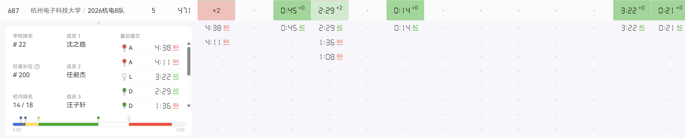
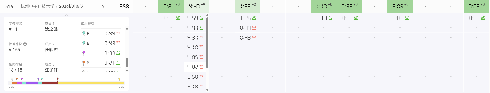

# 网络赛和 AFO

## 前言

~~咕了一个多月，终于来写这篇文章了~~

经过一个暑假的集训，感觉自己实力没什么提升。每周连续四天每天一场比赛，每天打完补完题，感觉很累，也很少有时间学习新知识和自主找题练习，唯一有意义的是我花了两周整理了自己的板子。

打过的比赛题看懂了，但是新比赛的题拿到还是很多想不出来，可能我确实没有足够强的思维能力，好多次都是队长一人想出几道 medium 的题带飞，剩下我和另一个队友就在那看题发呆，总是想不清楚做法。一暑假下来，估摸我们队的实力也就稳铜争银的水平，在集训队排在中下。

两次网络赛打完，也是不意外的没有机会去打区域赛了，感觉心里有了准备，也不是那么难受，大三估计也不会去参加了。在 AI 一年之间如此强盛之际，我也不断在思考打算法竞赛的意义，算法竞赛的题最强的 AI 都能解决，现在甚至有各种爆标事件，而且本身算法竞赛的做题风格就和做项目应用写的代码风格不一样，所以拿奖，只能说明一个人聪明。

我不否认拿奖牌对找工作的作用，但是随着 AI 的冲击，我觉得未来区域赛铜牌甚至银牌的含金量只会越来越小，不拿金牌感觉就意义不大了。（不是在给自己放弃找理由，其实大一就体验过各大 AI 和 Agent 了，早就想跑路了，只是大一一点没练还进队了，就想着去打打看）

## 网赛

感觉前言有点啰嗦了，不过其实还有很多能写，毕竟一个暑假集训还是有太多事情可写了，越写越停不下来，还是收住来写网络赛。

三场网赛杭电只打一场 ICPC 一场 CCPC，剩下一场我们自己出的不打，两场比赛过题数总和（相同算罚时）排序分配区域赛名额，我们总共 18 支队伍，进前 12 保底有两场 ICPC 区域赛打。

### The 2026 ICPC Asia East Continent Online Contest (I)

[补题链接](https://qoj.ac/contest/4071)

本场本人几乎零贡献，队长和另一位队友想题的速度比我快，而且 easy 和 meduim 又没有我很擅长的图论和大模拟，所以就只能帮队友写暴力对拍和造 hack 数据了。

#### F - 50 Years of Excellence

签到

```cpp
#include<bits/stdc++.h>
using namespace std;
#define ll long long 
#define db double 
#define il inline
#define INF 0x3f3f3f3f
#define LINF 0x3f3f3f3f3f3f3f3f
#define F(i,a,b) for(int (i)=(a);(i)<=(b);(i)++)
signed main()
{
	ios::sync_with_stdio(0);
	cin.tie(0);
	cout.tie(0);
	int n,m;
	cin>>n>>m;
	int lst=0,ans=0;
	F(i,1,n)
	{
		int sum=0;
		F(j,1,m)
		{
			int x=0;
			cin>>x;
			sum+=x;
		}
		if(sum<lst) ans++;
		lst=sum;
	}
	cout<<ans<<endl;
}
```

#### M - Check In

签到

```cpp
#include<bits/stdc++.h>
using namespace std;
const int N=1e6+10;
int trie[N][60];
int cnt=0;
int dict[2000];
int t[N];
void solve(){
	int n,m;
	cin>>n>>m;
	for(int i=0;i<n;i++){
		string s;
		cin>>s;
		int x=0;
		for(char c:s){
			int d=dict[c];
			if(!trie[x][d]){
				cnt++;
				trie[x][d]=cnt;
			}
			x=trie[x][d];
		}
		t[x]=1;
	}
	for(int i=0;i<m;i++){
		string s;
		cin>>s;
		int x=0;
		bool flag=1;
		for(char c:s){
			int d=dict[c];
			if(!trie[x][d]){
				flag=0;
				break;
			}
			x=trie[x][d];
		}
		if(!flag){
			cout<<"WRONG\n";
			continue;
		}
		if(t[x]==1){
			cout<<"OK\n";
			t[x]=2;
		}else{
			cout<<"REPEAT\n";
		}
		
	}
}
int main(){
	ios::sync_with_stdio(0);
	cin.tie(0);
	cout.tie(0);
	for(char c='a';c<='z';c++){
		dict[c]=c-'a';
	}
	for(char c='A';c<='Z';c++){
		dict[c]=c-'A'+30;
	}
	int T=1;
	while(T--){
		solve();
	}
}
```

#### C - Permutation Inversions

思路挺好想的，看到题就觉得是拓扑+贪心，先贪心的让 **编号小的点** 权值也小 ，这样逆序对应该是最少的，然后就可以对每个点向比他小的点建边跑拓扑排序，直接小根堆+拓扑。

队长想清楚后就开写了，一遍过。

```cpp
#include<bits/stdc++.h>
using namespace std;
const int N=1e6+10;
vector<int> adj[N];
int s[N];
int n;
void solve(){
	int T;
	cin>>n>>T;
	for(int i=1;i<=n;i++){
		adj[i].clear();s[i]=0;
	}
	while(T--){
		int l,r;
		cin>>l>>r;
		int m=r-l+1;
		vector<int>q(m);
		for(int i=0;i<m;i++){
			cin>>q[i];
		}
		for(int i=1;i<m;i++){
			adj[q[i-1]].push_back(q[i]);
			s[q[i]]++;
		}
		
	}
	int cnt=0;
	priority_queue<int,vector<int>,greater<int> >qu;
	for(int i=1;i<=n;i++){
		if(s[i]==0){
			qu.push(i);
		}
	}
	vector<int>ans;
	while(!qu.empty()){
		cnt++;
		int u=qu.top();ans.push_back(u);
		qu.pop();
		for(int v:adj[u]){
			s[v]--;
			if(s[v]==0){
				qu.push(v);
			}
		}
	}
	vector<int>f(n);int gpt=0;
	if(cnt==n){
		for(int u:ans){
			f[u-1]=++gpt;
		}
		bool fu=0;
		for(int u:f){
			if(fu==0){
				fu=1;
			}else{
				cout<<" ";
			}
			cout<<u;
			
		}
	}else{
		cout<<-1;
	}
	cout<<"\n";
}
int main(){
	ios::sync_with_stdio(0);
	cin.tie(0);
	cout.tie(0);
	int T;
	cin>>T;
	while(T--){
		solve();
	}
}
```

#### D - Sequence

过完三题后，队长去看 L 了，剩下两个我们在看 D。

刚开始题目还没修改，看完题，另一队友马上想到一个 $\mathcal{O}(n)$ dp，并且我们发现在固定输入情况下，很多情况答案都是 0，过样例交一发 wa 了，我写了暴力和对拍，拍了小数据没问题，百思不得其解。

然后题目有了修改，把输入一个序列改成了可重集，也就是说输入序列可以任意打乱，我们要找到可行的一个序列。

经过暴力尝试，我们发现对于小数据下每种输入都只有一个可行的序列，而且数据范围也不像有很多可能解情况，于是大胆猜测，马上想到一种贪心构造方式：

我们可以从小到大依次确定 $p_i$。假设当前状态为 $(a, b)$，且保证 $a \ge b$：

· 如果多重集中存在 b，我们优先选择 $p_i = b$。
· 否则，如果存在 a，选择 $p_i = a$。

感性理解十分正确，和小数据拍了一下也都没问题，然后构造完直接跑 dp 就过了。

```cpp
#include<bits/stdc++.h>
using namespace std;
#define ll long long 
#define db double 
#define il inline
#define INF 0x3f3f3f3f
#define LINF 0x3f3f3f3f3f3f3f3f
#define F(i,a,b) for(int (i)=(a);(i)<=(b);(i)++)
#define int ll
const int N=100010,P=998244353;
int dp[2][N],p0[N],p[N],t[N];
signed main()
{
	ios::sync_with_stdio(0);
	cin.tie(0);
	cout.tie(0);
	int n,k=0,ans=0;
	cin>>n;
	dp[k][0]=1;
	F(i,1,n)
	{
		cin>>p0[i];
		t[p0[i]]++;
	}
	int a=0,b=0;
	F(i,1,n)
	{
		if(t[b]) t[b]--,p[i]=b,a++;
		else if(t[a]) t[a]--,p[i]=a,b++;
		if(b>a) swap(a,b);
	}
	F(i,1,n)
	{
		k^=1;
		if(i-p[i]==p[i]) dp[k][p[i]]=(dp[k^1][i-1-p[i]]+dp[k^1][p[i]])%P;
		else dp[k][i-p[i]]=dp[k^1][i-1-p[i]],dp[k][p[i]]=dp[k^1][p[i]];
		dp[k^1][i-1-p[i-1]]=0,dp[k^1][p[i-1]]=0;
	}
	F(i,0,n) ans=(ans+dp[k][i])%P;
	cout<<ans%P;
}
```

#### L - Longest Common Prefix

过完 D，队长也基本想完 L 了，大概就是个 Trie 树上递推。

 $f_{i, j}$ 相当于是求 j 个字符串的 LCP，等价于在 Trie 树中找到一个节点，使得该节点被至少 j 个字符串经过（即节点的子树中包含至少 j 个字符串），并且该节点的深度尽可能大。

具体维护，我们记数组 $e[c]$：当前计数恰好为 c 的所有节点的最大深度，那么对于当前 i，$f_{i, j} = \max_{c \ge j} e[c]$。实际实现可以不求出 f 数组，只要考虑对 ans 的贡献怎么更新就行，细节看代码。

```cpp
#include<bits/stdc++.h>
using namespace std;
typedef long long ll;
const int N=5e5+10;
int trie[N][32];
int b[N][32];
int e[N];
int cnt=0;
ll t[N];
void solve(){
	int n;
	cin>>n;
	ll ans=0;
	for(int j=0;j<n;j++){
		string s;
		cin>>s;
		int x=0;
		int dep=0;
		t[0]++;
		dep=0;
		ans+=(j+1);
		for(char c:s){
			int d=c-'a';
			if(!trie[x][d]){
				cnt++;
				trie[x][d]=cnt;
			}
			x=trie[x][d];
			t[x]++;
			dep++;
			if(e[t[x]]<dep){
				ans=ans-(e[t[x]]^t[x])+(dep^t[x]);
				
				e[t[x]]=dep;
			}
		}
		cout<<ans<<"\n";
	}
}
int main(){
	ios::sync_with_stdio(0);
	cin.tie(0);
	int T=1;
	while(T--){
		solve();
	}
}
```

#### A - Recall (gg)

两场网络赛里最可惜的一题了，这题拿到题目时就读完题，也在做完前 4 题时有了思路，但是我们想的做法细节很多，最后直到 L 写完还剩一个半小时才来写，结果一个半小时都没调出来，越写越复杂，太可惜了，赛后看大家做法的时候才发现我最开始想的贪心想法是对的，只是赛时不会证正确性，可惜我最后还是没勇气在最后半小时叫停调题的队友去重构做法，最后痛失这关键一题，无缘区域赛。

关键思路是能 pop 就 pop，当一个数必须 pop 掉时，要确保在栈里他的上方没有必须要留在栈里的元素，以及确保一个数不同时在栈里存在多个。

因为题目保证有解，所以这个可以这样贪心，让每个元素尽可能早的 pop 掉。

```cpp
#include<bits/stdc++.h>
using namespace std;
#define For(i,l,r) for(int i=l;i<=r;i++)
#define int long long
typedef pair<int,int> Pii;

void solve()
{
    int n;
    cin>>n;
    vector<pair<string,int>> t(n);
    for(auto &[a,b]:t) cin>>a>>b;
    vector<int> xl;xl.reserve(n);
    for(auto &[a,b]:t) xl.emplace_back(b);
    sort(xl.begin(),xl.end());
    xl.erase(unique(xl.begin(),xl.end()),xl.end());
    for(auto &[a,b]:t) 
		b=lower_bound(xl.begin(),xl.end(),b)-xl.begin();

    vector<vector<int>> p(xl.size());
    for(int i=n-1;i>=0;i--)
    {
        auto&[a,b]=t[i];
        p[b].emplace_back((a=="+")?0:((a=="T")?1:2));
    }

    int num=0;
    stack<int>st;
    string s="";
    for(auto &[a,b]:t)
    {
        if(a=="+")
        {
            st.push(b);
            s.push_back('+');
        }
        else 
        {
            s.push_back('?');
        }
        p[b].pop_back();
        while(!st.empty())
        {
            auto now=st.top();
            if(p[now].empty()||(p[now].back()!=1))
            {
                s.push_back('-');
                st.pop();
            }
            else break;
        }
    }
    cout<<s<<'\n';
}
signed main()
{
	cin.tie(0)->sync_with_stdio(0);
	int T;cin>>T;
	while(T--)solve();
	return 0;
}
```

#### 结语



最后校内排名拉完了，也就意味着下一场如果我们不能打到中上，那就大概率会寄。也是很遗憾最后这个 A 没过。

赛后和 wzx 出去吃了滨寿司，第一次吃，出奇的美味，配得上价格。吃饭的时候在和他讨论如果没比赛打，后面做什么。他的想法和我也差不多，他在来集训之前就有数模队友在打数模了，只是被 ACM 推掉了，他大概后面会去找老队友打数模；而我在大一加入学校的信息安全社团，大概率后面会去打一些网络安全的比赛。我们都想的是万一没比赛打，也没必要浪费更多的时间在 ACM 上了，毕竟我们已经浪费了一整个暑假了。

### CCPC Online 2026

[补题链接](https://qoj.ac/contest/4128)

#### N - New CCPC Rules

签到

```cpp
#include<bits/stdc++.h>
using namespace std;
void solve(){
    int n,m;
    string s;
    cin>>n>>m>>s;
    if(s[1]>='4'){
        cout<<"YES\n";
        return;
    }
    if(m>=50){
        cout<<"YES\n";
        return;
    }
    if(m*5>=n){
        cout<<"YES\n";
        return;
    }
    cout<<"NO\n";
}

signed main(){
    ios::sync_with_stdio(0);
    cin.tie(0);
    int T=1;cin>>T;
    while(T--)solve();
    return 0;
}
```

#### B - Better Dice

签到

```cpp
#include<bits/stdc++.h>
#define int long long
using namespace std;
int n,m,a[7],b[10],c[7],k;
void dfs(int x,int y,int z)
{
	if(z<0) return ;
	if(x==7)
	{
		if(y>=19)
		{
			cout<<"YES\n";
			for(int i=1;i<=5;i++)cout<<c[i]<<' ';
			cout<<c[6]+z<<' ';
			exit(0);
		}
		return ;
	}
	for(int i=0;i<=6;i++)
		c[x]=b[i],dfs(x+1,y+i,z-b[i]);
}
signed main()
{
	for(int i=1;i<=6;i++) 
		cin>>a[i];
	cin>>k;
	sort(a+1,a+7);
	b[0]=1;
	for(int i=1;i<=6;i++) b[i]=a[i]+1;
	dfs(1,0,k);
	cout<<"NO\n";
    return 0;
}
```

#### I - Integer Triple

打表找规律，发现奇数无解，偶数时一定有一组解为 $1,-1,n/2$。

```cpp
#include<bits/stdc++.h>
using namespace std;
using ll = long long;
int main(){
	ll n;
	cin>>n;
	if(n%2==1){
		cout<<-1;
		return 0;
	}
	if(n==0){
		cout<<"0 0 0";
		return 0;
	}
	cout<<1<<" "<<n/2<<" "<<-1;
}
```

#### H - Hidden Permutation

通信题，没做过这种题，队长写的，一遍过。

```cpp
#include<bits/stdc++.h>
using namespace std;
const int N=2030;
int n;
int p[N];
int w[10][3]=
{
	1,2,3,
	1,3,2,
	2,1,3,
	2,3,1,
	3,1,2,
	3,2,1
};
struct node{
	int a[N];
}m[N];
bool cmp(node x,node y){
	return x.a[1]<y.a[1];
}
int main(){
	ios::sync_with_stdio(0);
	cin.tie(0);
	cout.tie(0);
	string opt;
	cin>>opt>>n;
	if(opt=="first"){
		for(int i=1;i<=n;i++){
			cin>>p[i];
		}
		if(n==3){
			int v;
			for(int i=0;i<6;i++){
				bool flag=1;
				for(int j=0;j<3;j++){
					if(w[i][j]!=p[j+1]){
						flag=0;
					}
				}
				if(flag){
					v=i;
					break;
				}
			}
			for(int i=1;i<=3;i++){
				cout<<i<<" ";
				int s,t;
				if(i==1)s=2,t=3;
				if(i==2)s=1,t=3;
				if(i==3)s=1,t=2;
				if(v%2==1){
					cout<<t<<" "<<s<<"\n";
				}else{
					cout<<s<<" "<<t<<"\n";
				}
				v/=2;
			}
		}else{
			for(int i=1;i<=n;i++){
				cout<<i<<" ";
				int mx=n;
				if(i==n)mx=n-1;
				if(p[i]==n){
					cout<<mx<<" ";
					for(int j=1;j<=n;j++){
						if(j!=i&&j!=mx){
							cout<<j<<" ";
						}
					}
				}else{
					int mn=1,cnt=1;
					if(i==1)mn=2;
					for(int j=1;j<p[i];j++){
						while(cnt==i||cnt==mn)cnt++;
						cout<<cnt<<" ";
						cnt++;
					}
					cout<<mn<<" ";
					for(int j=p[i]+1;j<n;j++){
						while(cnt==i||cnt==mn)cnt++;
						cout<<cnt<<" ";
						cnt++;
					}
				}
				cout<<"\n";
			}
		}
	}else{
		for(int i=1;i<=n;i++){
			for(int j=1;j<=n;j++){
				cin>>m[i].a[j];
			}
		}
		sort(m+1,m+n+1,cmp);
		if(n==3){
			int v=0;
			int g=1;
			for(int i=1;i<=n;i++){
				if(m[i].a[2]>m[i].a[3])v+=g;
				g*=2;
			}
			for(int i=0;i<3;i++){
				cout<<w[v][i]<<" ";
			}
		}else{
			for(int i=1;i<=n;i++){
				int mx=n;
				if(i==n)mx=n-1;
				if(m[i].a[2]==mx){
					cout<<n<<" ";
				}else{
					int mn=1;
					if(i==1)mn=2;
					int cnt=1;
					for(int j=2;j<=n;j++){
						if(m[i].a[j]==mn){
							break;
						}
						cnt++;
					}
					cout<<cnt<<" ";
				}
			}
		}
	}
}
```

#### E - EPS.AC

思路很简单，能分割就分割，难点在找一种 hash 的办法，判断三个序列其中有任意两个一段区间的 hash 值相等。赛时做法是记每个序列的前缀和，平方前缀和，立方前缀和，四次方前缀和，都相等就相等。

赛时代码被覆盖了，没存，赛后重新写了个优美很多的做法：

```cpp
#include<bits/stdc++.h>
using namespace std;
const int N=2e5+5;
int a[N],b[N],c[N],h[N];
void solve()
{
	int n;cin>>n;
	for(int i=1;i<=n;i++)h[i]=rand();
	for(int i=1;i<=n;i++)cin>>a[i];
	for(int i=1;i<=n;i++)cin>>b[i];
	for(int i=1;i<=n;i++)cin>>c[i];
	int x=0,y=0,z=0,ans=0;
	for(int i=1;i<=n;i++)
	{
		x^=h[a[i]],y^=h[b[i]],z^=h[c[i]];
		ans+=x==y||y==z||z==x;
	}
    cout<<ans<<'\n';
}
int main()
{
	srand(0);
	cin.tie(0)->sync_with_stdio(0);
	int T;cin>>T;
	while(T--)solve();
}
```

#### K - Keep on the Right Track

队长切了，没细看，赛后看了一下，是个拓扑加 dp，从 t 开始拓扑排序 DP，计算出每个节点到 t 的最短路条数，再计算期望，根据节点是否有信号决定 转移的系数即可（没信号的时候均分，有信号的时候从所有最短路中按照条数加权分配）。

```cpp
#include<bits/stdc++.h>
using namespace std;
using ll = long long;
int n,m,t;
const int N=2e5+10;
const ll mod=998244353;
ll ans[N];
ll dp[N];
struct node{
	int v;
	ll d;
	bool operator <(const node& other)const{
		return d>other.d;
	}
};
struct ed{
	int v;
	ll d;
};
vector<ed>adj[N];
bool sig[N];
ll dist[N];
void dij(){
	priority_queue<node>q;
	q.push({t,0});
	while(!q.empty()){
		auto cur=q.top();q.pop();
		int u=cur.v;ll d=cur.d;
		if(d!=dist[u]){
			continue;
		}
		for(auto e:adj[u]){
			int v=e.v;ll rd=e.d;
			if(d+rd<dist[v]){
				dist[v]=d+rd;
				q.push({v,d+rd});
			}
		}
	}
}
ed bdj[N];
ll po(ll x,ll t){
	if(t==0)return 1;
	ll tmp=po(x,t/2);
	tmp=tmp*tmp%mod;
	if(t%2==1)tmp=tmp*x%mod;
	return tmp;
}
ll inv(ll x){
	return po(x,mod-2);
	
}
int bs[N];
ll sz[N];
void sieve(){
	queue<int>q;
	q.push(t);
	dp[t]=1;
	while(!q.empty()){
		int u=q.front();
		cout<<u<<" "<<dp[u]<<"\n";
		q.pop();
		if(sig[u]==1)ans[u]*=inv(dp[u]);
		else ans[u]*=inv(sz[u]);
		ans[u]%=mod;
		for(auto cur:adj[u]){
			int v=cur.v;ll d=cur.d;
			if(sig[v]==1){
				if(dist[u]+d==dist[v]){
					ans[v]+=dp[u]*(ans[u]+d);
					ans[v]%=mod;
					cout<<u<<" "<<v<<" "<<d<<"\n";
				}
			}else{
				ans[v]+=ans[u]+d;
				ans[v]%=mod;
				sz[v]++;
				cout<<u<<" "<<v<<" "<<d<<"\n";
			}
			if(dist[u]+d==dist[v]){
				dp[v]=(dp[v]+dp[u])%mod;
			}
			bs[v]--;
			if(bs[v]==0){
				q.push(v);
			}
		}
	}
}
int main(){
	memset(dist,0x3f,sizeof(dist));
	cin>>n>>m>>t;
	dist[t]=0;
	for(int i=1;i<=n;i++){
		char c;
		cin>>c;
		sig[i]=c-'0';
	}
	for(int i=1;i<=m;i++){
		int u,v;
		ll d;
		cin>>u>>v>>d;
		adj[v].push_back({u,d});
		bs[u]++;
	}
	dij();
	sieve();
	for(int i=1;i<=n;i++){
		cout<<ans[i]<<" ";
	}
}
```

#### C - Cross the Road

噩梦开始，这题开始做的时候还有两个半小时，看完题发现是中等模拟，分类讨论物理追及问题，结果这题写了两个半小时，在最后 15min 才过，依旧被神秘题目卡住，虽然后面确实也没想出来其他题。

物理题，式子推出来基本就做完了，无非一些分讨时候的细节要注意，但是我和 wzx 写的第一版交五六发，几乎把问题找完了，就是 wa，反复验证式子和细节，构造特殊例子，但就是不对，我们怀疑是精度误差太大，我还以为又要像第一场那样带着遗憾离场。最后一小时，队长听完题意，开始接手，他推的式子比我们更简洁，直接算出时间，而不是像我们推的先解方程算距离，再算时间。而且我们发现这么写不少讨论可以避免，有了我们前面试出来的各种边界问题，队长写完直接两发就过了 $\text{orz}$ 。 

```cpp
#include<bits/stdc++.h>
using namespace std;
using db = double ;
db d(db a,db b,db c){
	return b*b-4*a*c;
}
int main(){
	int T;
	cin>>T;
	while(T--){
		db w,x1,x2,y,u,v;
		cin>>w>>x1>>x2>>y>>u>>v;
		db nt=y;
		db ans=1e15;
		if((x1*v+u*nt<=0&&x2*v+u*nt<=0)||(x1*v+u*nt>=0&&x2*v+u*nt>=0)){
			ans=w/v;
		}else{
			db a=v*v-u*u;
			w-=y;
			db d1=d(a,2*x1*u,-x1*x1-y*y),d2=d(a,2*x2*u,-x2*x2-y*y);
			if(abs(a)<=0.003){
				db t1=(x1*x1+y*y)/-2.0/x1/u,t2=(x2*x2+y*y)/-2.0/x2/u;
				if(t1<0)t1=1e15;
				if(t2<0)t2=1e15;
				ans=min(abs(t1),abs(t2))+w/v;
			}else{
				if(d1>=0){
					db t1=((2.0*x1*u)-sqrt(d1))/2.0/a,t2=((2.0*x1*u)+sqrt(d1))/2.0/a;
					cout<<t1<<" "<<t2<<"\n";
					if(t1<0)t1=1e15;
					if(t2<0)t2=1e15;
					ans=min(ans,min(t1,t2)+w/v);
				}
				if(d2>=0){
					db t1=((2.0*x2*u)-sqrt(d2))/2.0/a,t2=((2.0*x2*u)+sqrt(d2))/2.0/a;
					if(t1<0)t1=1e15;
					if(t2<0)t2=1e15;
					ans=min(ans,min(t1,t2)+w/v);
				}
			}
		}
		printf("%.7lf\n",ans);
	}
}
```

#### 结语



看上去过了 7 题，但是罚时垫底，校排甚至比第一场还低。最后也是意料之中，差一题痛失区域赛资格，竞争确实残酷，不过过程的体验还是很丰富的，各种经历我大概不会写下来，但是会成为我以后追忆大一时光的重要一部分。

### 结结语

终于一次性写完了这篇博文，真怕写一半就咕那里了。

这篇文章其实还有很多东西想写，但是大概率后面也不会更新了，这样留白挺好的（雾。

从这之后大概不会再打 ACM 了，所以这也是我退役帖了，那就最后再写个独特的 AFO 吧，告别我那高中到大学的算法竞赛经历。
$$
\large{\mathcal{AFO.}}
$$
