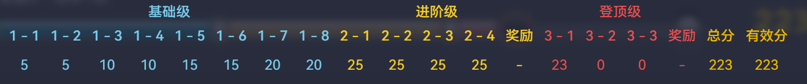

### Team：杭电5队

第一次参加天梯赛团队赛，感觉是个规则比较抽象的比赛（一队 10 人打个人赛，求和算团体总分，学校前三队伍算学校总分），今年题比较阳间，但是赛时不知道怎么看榜，错失个人国二。

最终得分 223，差 3 分国二。最后两题没骗分，喜提团队垫底，最终团队国三。

L1，L2 整体感觉比前几年阳间，基本直接模拟就过了，一个半小时做完。

L3-1 中等模拟，赛时写了个 $n^2$ 做法，时限 100ms 两个点 $T$ 了，以为卡 $ n^2$，思考了一下用 set 优化到 log 写起来很麻烦，当时还有 40min，所以直接去看后面两个题了。

L3-3 看了眼只会 dfs 找全部可能取法，感觉拿不了分，先去看L3-2，感觉正解像 dp 或者高妙贪心，因为看不了榜，不知道能骗多少分，当时想了个比较难写的贪心做法，就是每次找两种颜色中相同类型个数最大的删，但是要动态维护，写起来也挺麻烦的，结果没调完。

赛后和同学沟通后才知道，L3-1 $n^2$ 能过，但是我用 vector 应该常数太大 $T$ 了。L3-2 写个简单的贪心就能拿 12/16 分。L3-3 打个 dfs 爆搜就能拿 10分，全场暴力打满 256 就有国一，只能说没看榜确实可惜，至少拿国二。

学校排名，我们第三，也是和往年差不多，主要前面题比较阳间，后面就是比难题得分了，这个确实和前两位有差距。

