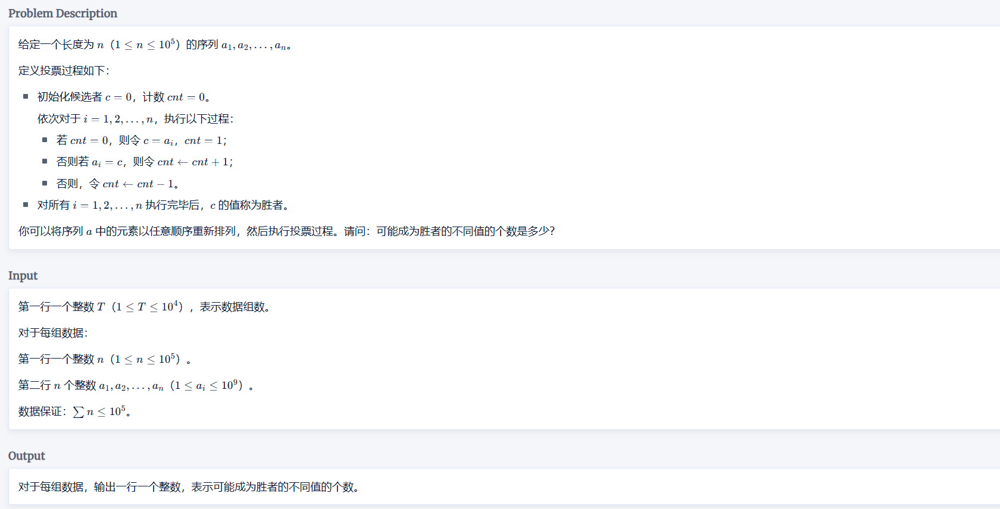
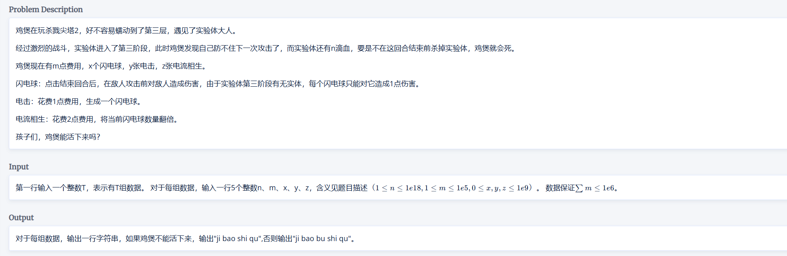
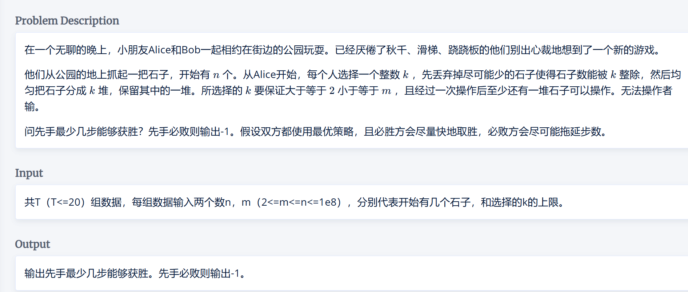
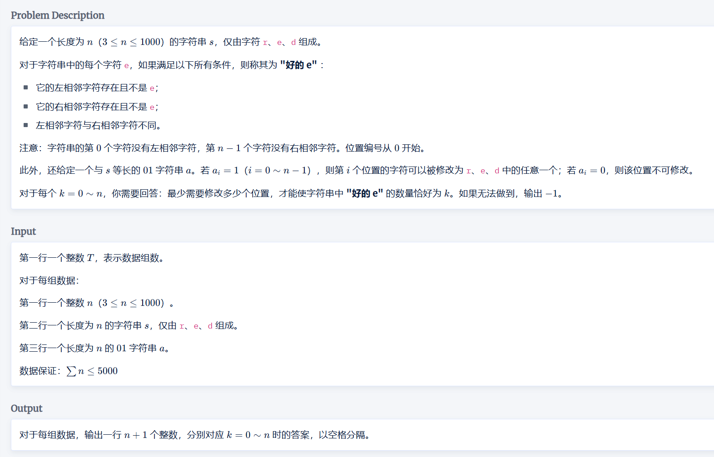
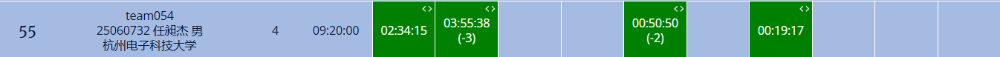
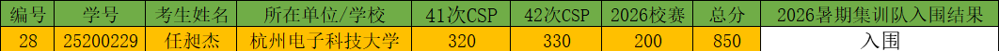

## “华为杯”杭州电子科技大学第二十六届大学生程序设计竞赛

个人赛，解题数*50+前两次 CSP 的总分来选拔暑假集训队。

### 赛前

以为是一点开打，11 点 45 分下楼拿外卖的时候发现是 12 点比赛，来不及吃饭，直接去打了。~~（饿饿饿）~~

### 赛中

准点赶到，登完号看题，想随榜做题，发现过了 5 min 才有人过题，意识到这次题不简单。

 $1007$ **投票游戏**



应该是签到题，看完题，首先想到 如果一个数出现次数 $>n/2$，那么无论怎么排列，最终胜者肯定是这个数，其他数没法把这个数全消掉。然后猜一下结论，其余情况，答案应该是不同数的种数，因为想让一个数成为胜者，只需在前面把其他数消掉，最后放这个数就行了。

$Code:$

```cpp
#include<bits/stdc++.h>
using namespace std;
const int N=1e5+5;
int a[N];
signed main(){
	cin.tie(0)->sync_with_stdio(0);
	int T;cin>>T;
	while(T--){
		int n;cin>>n;
		for(int i=1;i<=n;i++)cin>>a[i];
		sort(a+1,a+n+1);
		int res=1,mx=0,len=1;
		for(int i=2;i<=n;i++){
			if(a[i]==a[i-1])len++;
			else len=1,res++;
			mx=max(mx,len);
		}
		if(mx<=n/2)cout<<res<<'\n';
		else cout<<1<<'\n';
	}
	return 0;
}
```

 $1005$ **鸡煲是区**



过的人第二多的，确实不难，但是刚开始想错了，以为是贪心，想了一些错误做法。

直接说做法吧，把整个题写成式子：$n<=(x+y^{'})^{z^{'}},m>=y^{'}+2\times z^{'}$，发现只有两个变量，而且两个变量最大不超过 $m$，所以直接枚举其中一个即可。

 $Code:$

```cpp
#include<bits/stdc++.h>
using namespace std;
#define int long long
int n,m,x,y,z;
signed main(){
	cin.tie(0)->sync_with_stdio(0);
	int T;cin>>T;
	while(T--){
		cin>>n>>m>>x>>y>>z;
		if(x==0&&y==0){
			cout<<"ji bao shi qu\n";
			continue;
		}
		bool flag=0;
		for(int i=0;i<=min(m,y);i++){
			int t=x+i,s=m-i;
			if(t==0)continue;
			int zz=z;
			while(zz&&s>=2&&t<n){
				zz--,s-=2,t*=2;
			}
			if(t>=n){
				flag=1;break;
			}
		}
		if(!flag)cout<<"ji bao shi qu\n";
		else cout<<"ji bao bu shi qu\n";
	}
	return 0;
}
```

 $1001$ **取石子游戏**



看完题，是博弈论~~（一眼不会）~~，猜了半天结论，感觉都不对，看了其他题感觉也没那么好做，~~开始坐牢~~。

比赛时间过半，意识到如果博弈双方都取 $2$ 的话，最终步数只有 $log(n)$ 很小，如果必胜方要更快，会取 $2^x$，来加快步数，然后发现 时限给了 $6s$，想写个爆搜试一下，发现直接过了，我甚至没做任何剪枝。。。

$Code:$

```cpp
#include<bits/stdc++.h>
using namespace std;
#define int long long
const int N=1005;
int n,m,ans;
void dfs(int n,int m,int s){
	if(n<m*2){
		if(s&1)ans=min(ans,s);
		return ;
	}
	if(s&1){
		for(int i=m;i>=2;i--){
			dfs(n/i,m,s+1);
		}
	}
	else{
		for(int i=2;i<=m;i++){
			dfs(n/i,m,s+1);
		}
	}
}
signed main(){
	cin.tie(0)->sync_with_stdio(0);
	int T;cin>>T;
	while(T--){
		cin>>n>>m;
		ans=1e5;
		dfs(n,m,1);
		if(ans==1e5)cout<<"-1\n";
		else cout<<ans<<'\n';
	}
	return 0;
}
```

 $1002$ **e**

此时，时间只剩一个半小时了，上了个厕所调整一下，开始看有点思路的 $1002$。



看完题，一眼丁 $DP$，感觉处理起来很棘手，设状态函数：$f_{i,j,b,c}$ 表示 $s_{1 \thicksim i}$ 组成的字符串，有 $j$ 个**好的 e**，第 $i$ 个字符是 $b$，前一个字符是 $c$ 的最少修改次数。

预处理把 $erd$ 赋值为 $012$，方便写转移条件。

初始化：$\begin{cases} f[1][0][a[1]][0]=0 \\ f[1][0][i][0]=1 &{{s2}_{1}=\text{'1'},i \neq a_1} \end{cases}$

转移：$\begin{cases} f[i][j][b][c]=min~{f[i-1][j][c][d]+(b!=a[i])} & \text{!(i>2 \& b \& d \& b!=d \& !c)} \\ f[i][j+1][b][c]=min~f[i-1][j][c][d]+(b!=a[i]) &\text{i>2 \& b \& d \& b!=d \& !c} \end{cases}$

其他细节就不放了，自己看码。

$Code:$

```cpp
#include<bits/stdc++.h>
using namespace std;
const int N=1005,inf=0x3f3f3f3f;
int n;
string s1,s2;
int f[N][N][3][3];
int a[N];

signed main(){
	cin.tie(0)->sync_with_stdio(0);
	int T;cin>>T;
	while(T--){
		cin>>n>>s1>>s2;s1="~"+s1,s2="~"+s2;
		for(int i=1;i<=n;i++){
			if(s1[i]=='r')a[i]=1;
			else if(s1[i]=='d')a[i]=2;
			else a[i]=0;
		}
		memset(f,0x3f,sizeof(f));
		f[1][0][a[1]][0]=0;
		if(s2[1]=='1'){
			for(int i=0;i<=2;i++){
				if(a[1]==i)continue;
				else f[1][0][i][0]=1;
			}
		}
		for(int i=2;i<=n;i++){
			for(int j=0;j<=i/2;j++){
				
				for(int b=0;b<=2;b++){
					if(s2[i]=='0'&&b!=a[i])continue;
					for(int c=0;c<=2;c++){
						for(int d=0;d<=2;d++){
							if(i==2&&d)continue;
							if(i>2&&b&&d&&b!=d&&!c){
								f[i][j+1][b][c]=min(f[i][j+1][b][c],f[i-1][j][c][d]+(b!=a[i]));
							}
							else f[i][j][b][c]=min(f[i][j][b][c],f[i-1][j][c][d]+(b!=a[i]));
						}
					}
				}
			}
		}
		for(int i=0;i<=n;i++){
			int res=inf;
			for(int b=0;b<=2;b++){
				for(int c=0;c<=2;c++){
					res=min(res,f[n][i][b][c]);
				}
			}
			if(res==inf)cout<<"-1 ";
			else cout<<res<<' ';
		}cout<<'\n';
	}
	return 0;
}
/*
1
8
rederded
00000000

-1 -1 0 -1 -1 -1 -1 -1 -1
*/
```

预处理写挂调了半天，最后 5 min 调完过题，下班。

### 赛后

终榜：



大部分人都是 4~5 个题，只是罚时高了，写的快可以拿三等奖。

自我评价是打的中规中矩，确实也符合我这学期基本没怎么刷题的水平。

最终也是进队了。~~暑假要没的放松了。。。~~


