## 队伍 ：Rencj #000a9a

# Week1

## MISC

### 打好基础

txt是一堆表情包，应该是Base100加密，直接放进随波逐流一键解码

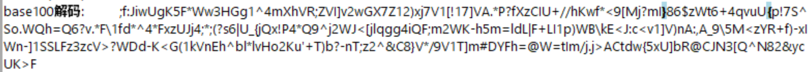

发现乱码，继续放进去一键解码，发现是base混合多重解码

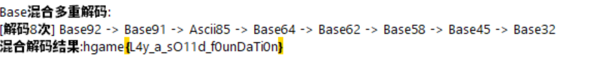

### shiori不想找女友

zip解压得到一个加密zip和一张png，png中有规律黑白像素，010Editor中发现有像素提取提示

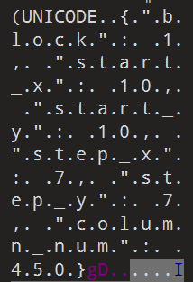

根据提示写代码提取像素生成新图片,得到压缩包密码`This_is_a_key_for_u`

```Python
from PIL import Image
img = Image.open("shiori.png")
width, height = img.size
pixels = img.load()
start_x, start_y = 10, 10
step_x, step_y = 7, 7
target_width = 450  # 题目给出的 column_num
extracted_bits = []
# 3. 遍历原图提取数据 (流式提取)
for y in range(start_y, height, step_y):
    for x in range(start_x, width, step_x):
        r, g, b = pixels[x, y]
        if r + g + b < 300: 
            extracted_bits.append(1)
        else:
            extracted_bits.append(0)
print(f"共提取到 {len(extracted_bits)} 个数据点")
# 5. 计算新图高度并重绘
target_height = len(extracted_bits) // target_width
if len(extracted_bits) % target_width != 0:
    target_height += 1
print(f"正在生成新图: {target_width} x {target_height}")
new_img = Image.new('RGB', (target_width, target_height), (255, 255, 255))
new_pixels = new_img.load()
idx = 0
for y in range(target_height):
    for x in range(target_width):
        if idx >= len(extracted_bits):
            break
        if extracted_bits[idx] == 1:
            new_pixels[x, y] = (0, 0, 0)
        idx += 1
new_img.show()
new_img.save("flag_result.png")
```


解压加密zip得到一张jpg，放进010Editor中发现结构是png，后缀改成png发现图片是张空白，扔进Stegsolve中改通道，得到flag

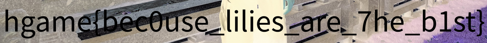

### **[REDACTED]** 

 兔兔说她对一份机密文件进行了“完美的”脱敏处理。还好你在发送之前检查了一下。

 提交说明： 附件中包含四段敏感字符串，格式为 `[1-4]:.+`。用下划线字符 `_` 连接去掉序号的四段字符串，包裹 `hgame{}` 后提交。例如，若四段敏感字符串分别为 `1:Example`、`2:Redacted`、`3:Secret`、`4:Strings_!`，则提交的 flag 为 `hgame{Example_Redacted_Secret_Strings_!}`。

解压得 manual.pdf，打开发现有两段黑色块覆盖文本，有一张图片中的一小段文本被遮。

第一段文本直接复制出来得到 `1:PAR4D0X`。

第二段黑色块中文字直接复制出来是乱码，应该是用了奇怪的字体，把 pdf 丢进轻闪PDF 中对第二段黑色块上遮盖的黑色块删除并把文本颜色改成黑色得到文本

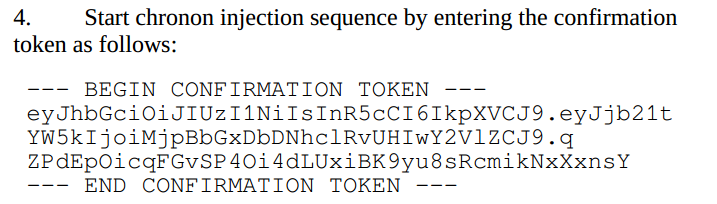

OCR 一下 base64 解密

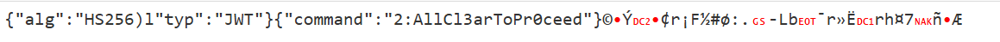

得到 `2:AllCl3arToPr0ceed`

在轻闪 PDF 中把图片提取出来，放入 Stegsolve 中改通道，得到 `3:Sh4m1R`

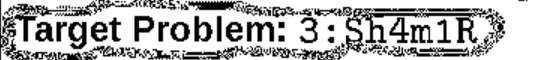

在010Editor中发现文件末尾有增量更新，删掉后打开 pdf 找到 `4:D0cR3qu3st3r_Tutu`

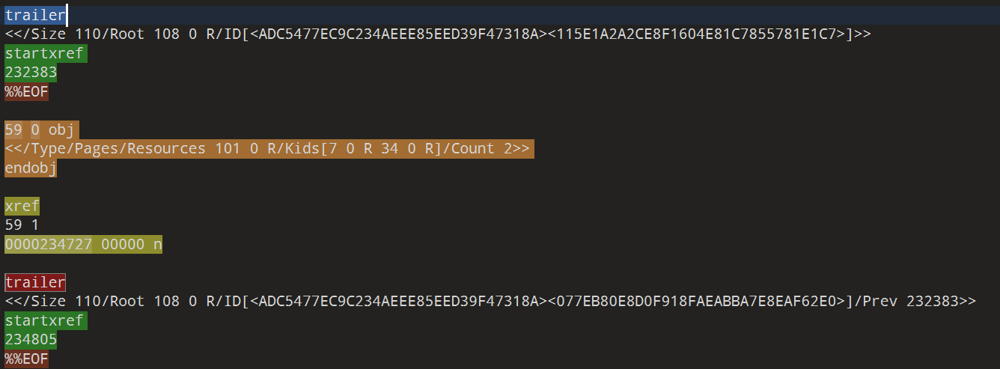

组合得 flag：`hgame{PAR4D0X_AllCl3arToPr0ceed_Sh4m1R_D0cR3qu3st3r_Tutu}`

## Crypto

### Classic

task.py是一个泄露 p 高位 leak 的 RSA，可用 Coppersmith 攻击可以还原完整的 p，然后分解 n 并解密得到明文 m；

txt里是一段密文`VUHHX{Tti Julxmzooz sm zhq Rlc azh ane Apk}`

先解密明文：

```Python
from Crypto.Util.number import long_to_bytes
n = 103581608824736882681702548494306557458428217716535853516637603198588994047254920265300207713666564839896694140347335581147943392868972670366375164657970346843271269181099927135708348654216625303445930822821038674590817017773788412711991032701431127674068750986033616138121464799190131518444610260228947206957
leak = 6614588561261434084424582030267010885893931492438594708489233399180372535747474192128
c = 38164947954316044802514640871285562707869793354907165622336840432488893861610651450862702262363481097538127040490478908756416851240578677195459996252755566510786486707340107057971217557295217072867673485369358370289506549932119879791474279677563080377456592139035501163534305008864900509896586230830001710243
e = 65537

p_high = leak << 230
PR.<x> = PolynomialRing(Zmod(n))
f = p_high + x
res = f.small_roots(X=2^230, beta=0.5, epsilon=0.03)
p = int(p_high + res[0])
q = n // p
d = inverse_mod(e, (p-1)*(q-1))
m = pow(c, d, n)
print(long_to_bytes(m))
```

解得`b'Vigenere,key=hgame'`，得到密文是 Vigenere 加密，密钥是 hgame ，解密得 `VIDAR{The Collision of the New and the Old}`

### Flux

**首先要解出参数 (a, b, c)**

题目给出了连续的四个输出 x1, x2, x3, x4，它们满足 $x_{i+1} = (a x_i^2 + b x_i + c) \pmod n$

通过构建方程组：

$\begin{cases} x_2 - x_3 = a(x_1^2 - x_2^2) + b(x_1 - x_2) \\ x_3 - x_4 = a(x_2^2 - x_3^2) + b(x_2 - x_3) \end{cases}$

这是一个关于 a, b 的线性方程组，可以直接求解。解出 a, b 后带回原方程求 c。

**然后还原初始****哈希值** $ h(x_0) $:

已知 $x_1 = (a x_0^2 + b x_0 + c) \pmod n$，这是一个关于 $x_0 $ 的一元二次方程。

变形为 $a x_0^2 + b x_0 + (c - x_1) = 0 \pmod n$。

使用求根公式（要用 Tonelli-Shanks 算法求解二次剩余）即可得到 h 的两个可能值。

**最后逆推 Key** :

`shash` 函数的核心逻辑是：$x_{new} = (key \cdot x_{old}) \oplus c$（忽略 mask 和位移细节）。

由于涉及乘法和异或，**低位的运算结果只依赖于低位的输入**。也就是说，结果的第 i 位只取决于 key 的第 $0 \sim i$ 位。

利用这一特性，我们可以**逐位爆破** key：

- 先猜 key 的第 0 位（0 或 1），检查哈希结果的第 0 位是否匹配。
- 若匹配，再猜第 1 位，检查结果的第 1 位是否匹配（需累计计算）。
- 以此类推，直到恢复出 70 位的 key。

```Python
import libnum
from Crypto.Util.number import *

# 1. 数据准备
data = [
    259574080588277578527410299002867735023798216356763871244908783144610527451187, 
    954408432127642232121971189554605898975195279656270435479524132958262607464595, 
    902461413507524665418054778947872375987908929501605791883614896110219051835312, 
    92554599789649828855418140915311664257163346975111310560999959858873425332254
]
n = 1000081851369905197391900354119969103949357074708517572641608490670646955240669

x1, x2, x3, x4 = data

print("[+] Step 1: Recovering LCG parameters...")
A1 = (pow(x1, 2, n) - pow(x2, 2, n)) % n
B1 = (x1 - x2) % n
C1 = (x2 - x3) % n
A2 = (pow(x2, 2, n) - pow(x3, 2, n)) % n
B2 = (x2 - x3) % n
C2 = (x3 - x4) % n

det = (A1 * B2 - A2 * B1) % n
det_inv = libnum.invmod(det, n)

a = (C1 * B2 - C2 * B1) * det_inv % n
b = (A1 * C2 - A2 * C1) * det_inv % n
c = (x2 - a * pow(x1, 2, n) - b * x1) % n

print(f"    a = {a}")
print(f"    b = {b}")
print(f"    c = {c}")

print("[+] Step 2: Recovering h (x0)...")
# 方程: a*h^2 + b*h + (c - x1) = 0
target_const = (c - x1) % n
discriminant = (pow(b, 2, n) - 4 * a * target_const) % n

# 修复点：libnum.sqrtmod 需要传入 factors 字典 {n: 1}
factors = {n: 1} 

h_candidates = []
if libnum.has_sqrtmod(discriminant, factors):
    inv_2a = libnum.invmod(2 * a, n)
    roots = list(libnum.sqrtmod(discriminant, factors))
    for r in roots:
        x0 = ((-b + r) % n) * inv_2a % n
        h_candidates.append(x0)
    print(f"    Candidates: {h_candidates}")
else:
    print("[-] No solution for h")
    exit()

print("[+] Step 3: Recovering Key (Bit-wise DFS)...")

msg = "Welcome to HGAME 2026!"
final_xor = len(msg)

# 目标哈希函数逻辑def shash(value: str, key: int) -> int:
    length = len(value)
    mask = (1 << 256) - 1
    x = (ord(value[0]) << 7) & mask
    for c in value:
        x = (key * x) & mask ^ ord(c)
    x ^= length & mask
    return x

# 逐位爆破求解器def solve_recursive(k_curr, bit_to_find, target_val):if bit_to_find == 70: # 题目限制 key < 70 bitsreturn k_curr
        
    # 当前检查的掩码（只看低 bit_to_find+1 位）
    mask_check = (1 << (bit_to_find + 1)) - 1# 尝试当前位是 0 还是 1for bit in [0, 1]:
        k_next = k_curr | (bit << bit_to_find)
        
        # 模拟 shash 过程，但只关注低位# 注意：中间变量 x 在迭代中会积累高位信息，必须在最后比较前 mask# 且在每一步迭代中，(k*x) 的低位只受 x 低位和 k 低位影响
        
        x = (ord(msg[0]) << 7) & mask_check
        for char in msg:
            x = (k_next * x) & mask_check ^ ord(char)
        x ^= final_xor & mask_check
        
        # 检查是否与目标的低位一致if (x & mask_check) == (target_val & mask_check):
            res = solve_recursive(k_next, bit_to_find + 1, target_val)
            if res is not None:
                return res
    return None

real_key = Nonefor h in h_candidates:
    # 尝试解出 key
    res = solve_recursive(0, 0, h)
    if res is not None:
        # 二次验证全量哈希if shash(msg, res) == h:
            real_key = res
            print(f"    Found Key: {real_key}")
            breakif real_key:
    magic_word = "I get the key now!"
    flag_hash = shash(magic_word, real_key)
    flag = "VIDAR{" + hex(flag_hash)[2:] + "}"
    print(f"[+] FLAG: {flag}")
else:
    print("[-] Failed to find key.")
```

解得flag：`VIDAR{1069466028b4c4a9694a3175f2f9410ab398b939bdb52afb39534b6f8cc59abc}`

## Reverse

### PVZ

解压打开exe发现提示需要 java 环境，丢到 DIE 中发现 exe 是 java 套壳

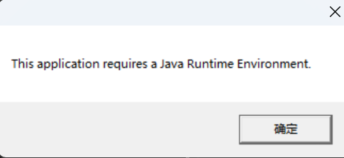

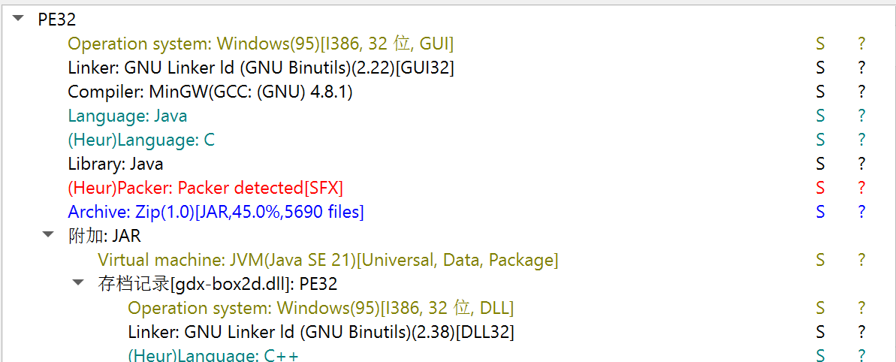

把 exe 后缀改 zip 尝试解压，解压成功，在 `...\com\pvz\vidar\game\wsdx233\top\screen`里找到  FlagScreen.class，这是 flag 的加密代码，flag 是根据变量 zombieKillCount 的值生成，所以只要根据加密函数写出对应解密代码，然后暴力尝试 zombieKillCount 匹配找到 flag 即可，以下是解密代码：

```Python
from typing import List

kill_encrypted = [0, -8, -6, 6, 31, -39, -104, 114, 86, -23, -35, 28, -122, 56, 29, -126, -29, 94, 23, -29, 46, -126, -4, 45, 20, -57]
# 将有符号字节转换为 0-255 的无符号表示
kill_encrypted = [b & 0xFF for b in kill_encrypted]
hello = 4359010814435432432
xor_key1 = 102
xor_key2 = 119
aes_encrypted_key = [74, -111, -61, 127, 46, -75, 104, -44, 28, -119, 58, -14, 93, -90, 113, -66]
aes_encrypted_key = [b & 0xFF for b in aes_encrypted_key]

# 源代码中给出的替换对（substitution 表），下方构造反向映射
sub_pairs = [('A','Q'),('B','W'),('C','E'),('D','R'),('E','T'),('F','Y'),('G','U'),('H','I'),('I','O'),('J','P'),('K','A'),('L','S'),('M','D'),('N','F'),('O','G'),('P','H'),('Q','J'),('R','K'),('S','L'),('T','Z'),('U','X'),('V','C'),('W','V'),('X','B'),('Y','N'),('Z','M'),('_','!'),('{','['),('}',']')]
# 反向映射：从替换后的字符映回原字符（value -> key）
reverse_sub = {v:k for (k,v) in sub_pairs}

def derive_key_from_killcount(var1: int) -> bytes:
    # 模拟 Java 的 int 行为：var1 应为 32 位整数，但 Python 使用任意精度整型
    var3 = (var1 * 31 + 17) % 997
    var4 = (var1 * 37 + 23) % 991
    var5 = (var1 * 41 + 29) % 983
    var6 = (var3 ^ (var4 << 3) ^ (var5 >> 2)) % 256
    var7 = (var1 * 7 + var3 + var4 + var5) % 65536
    out = bytearray(16)
    var9 = var7
    for i in range(16):
        var9 = (var9 * 1103515245 + 12345) & 0x7FFFFFFF
        out[i] = ((var9 >> 16) % 256)
    return bytes(out)

def decrypt_with_killcount(data: List[int], key_seed: int) -> bytes:
    key = derive_key_from_killcount(key_seed)
    out = bytearray(len(data))
    for i in range(len(data)):
        v = data[i]
        var7 = key[i % len(key)]
        var8 = (i * 13 + 7) % 256
        out[i] = v ^ var7 ^ var8
    return bytes(out)

def xor_decrypt(data: bytes, k: int) -> bytes:
    return bytes([(b ^ k) & 0xFF for b in data])

def simple_aes_decrypt(data: bytes, key: List[int]) -> bytes:
    out = bytearray(len(data))
    for i in range(len(data)):
        out[i] = data[i] ^ key[i % len(key)]
    return bytes(out)

def rotate_decrypt(s: str, rot: int) -> str:
    res = []
    for ch in s:
        if 'A' <= ch <= 'Z':
            idx = (ord(ch) - 65 - rot) % 26
            res.append(chr(65 + idx))
        elif 'a' <= ch <= 'z':
            idx = (ord(ch) - 97 - rot) % 26
            res.append(chr(97 + idx))
        else:
            res.append(ch)
    return ''.join(res)

def substitution_decrypt(s: str) -> str:
    out = []
    for ch in s:
        out.append(reverse_sub.get(ch, ch))
    return ''.join(out)

def get_rotation_offset() -> int:
    s = "PLANTS_VS_ZOMBIES_2025"
    tot = sum(ord(c) for c in s)
    return tot % 26

ROT = get_rotation_offset()

def try_decrypt_for(zcount: int) -> str:
    # 模拟 Java 中 (hello + zcount) 转为 int 的行为（取低 32 位）
    val = (hello + zcount) & 0xFFFFFFFF
    # Java 的 int 是有符号的；但 deriveKeyFromKillCount 内部使用模运算，取低 32 位也能复现行为
    dec = decrypt_with_killcount(kill_encrypted, val)
    half = len(dec) // 2
    a = dec[:half]
    b = dec[half:]
    part1 = xor_decrypt(a, xor_key1)
    part2 = xor_decrypt(b, xor_key2)
    merged = part1 + part2
    aes = simple_aes_decrypt(merged, aes_encrypted_key)
    try:
        s = aes.decode('utf-8')
    except Exception:
        return None
    s = rotate_decrypt(s, ROT)
    s = substitution_decrypt(s)
    return s

if __name__ == '__main__':
    # 暴力搜索合理范围，这里尝试 0..200000
    for z in range(0, 200001):
        res = try_decrypt_for(z)
        if res is None:
            continue
        if len(res) == 26 and res.startswith('flag{') and res.endswith('}'):
            print('FOUND', z, res.replace('flag','hgame'))
            break
    else:
        print('NOT FOUND')
FOUND 36278 hgame{BECAUSE_I_AM_CRAAAZY}
```

### **Signal Storm**

用 ida 打开，先找字符串，找到密钥`'C0lm_be4ore_7he_st0rm'`

找到主函数，发现函数开头有一段反调试语句，会读取 `/proc/self/status` 检查 `TracerPid` 字段，如果 `TracerPid` 不为 0（即程序正在被调试器跟踪），程序会进入一个错误解密分支，对密钥字符串进行异或操作，所以直接静态分析伪代码，找到加密函数分析发现是 RC4 算法。

**加密过程：**

1. 先用标准 KSA 算法用密钥打乱 S 盒，
2. 然后用 PRGA 生成 KeyStream，不过这个 PRGA 与标准相比有改动，标准 RC4 仅用 `S[i]` 更新 `j`，但这道题还加了当前密钥字符：$j = (j + S[i] + \text{Key}[i \pmod{21}]) \pmod{256}$
3. 最后还做了移位操作，把密钥字符串向左移动 1 位。

写出解密代码：

```Python
import struct

def ksa(key, S):
    j = 0
    key_len = len(key)
    for i in range(256):
        j = (j + S[i] + key[i % key_len]) % 256
        S[i], S[j] = S[j], S[i]
    return S

def solve():
    # 1. 提取密文 
    targets = [
        0x8260C1C9C8D936E3, 
        0x1C4BB2D52511D975, 
        0xF11CAF1C716DE64D, 
        0x1A5AF67F261CA506
    ]
    ciphertext = b''
    for t in targets:
        ciphertext += struct.pack('<Q', t)

    # 2. 准备密钥
    key_str = "C0lm_be4ore_7he_st0rm"
    key = [ord(c) for c in key_str]
    
    # 3. 初始化 S 盒 (仅一次)
    S = list(range(256))
    S = ksa(key, S)
    
    # 4. 解密循环
    i = 0
    j = 0
    flag = []

    for k in range(32):
        # --- 变种 PRGA ---
        i = (i + 1) % 256
        
        # 混入 Key (注意 Key 是动态变化的)
        current_k = key[i % 21]
        j = (j + S[i] + current_k) % 256
        
        S[i], S[j] = S[j], S[i]
        
        # 生成密钥流并解密
        t = (S[i] + S[j]) % 256
        k_byte = S[t]
        flag.append(ciphertext[k] ^ k_byte)
        
        # --- 密钥移位 (Rotate Left 1) ---
        first = key.pop(0)
        key.append(first)

    print("Flag:", bytes(flag).decode('utf-8'))

solve()
```

得到 flag：`hgame{Null_c0lm_wi7hout_0_storm}`

## Web

### **魔理沙的魔法目录**

F12 发现有个 record 得 POST 请求和 check 得 GET 请求，根据提示应该是要时长到达一定值时 check 会返回 flag，直接在 HackBar 中修改 POST 请求中的数据 `{"time":10}`，把 10 改成100000，发送即可

```Bash
POST /record HTTP/1.1
Authorization: eedef51e-792d-4900-8e36-42c7da1adf2f
Upgrade-Insecure-Requests: 1
User-Agent: Mozilla/5.0 (Windows NT 10.0; Win64; x64) AppleWebKit/537.36 (KHTML, like Gecko) Chrome/144.0.0.0 Safari/537.36
Accept: text/html,application/xhtml+xml,application/xml;q=0.9,image/avif,image/webp,image/apng,*/*;q=0.8,application/signed-exchange;v=b3;q=0.7
Accept-Encoding: gzip, deflate
Accept-Language: zh-CN,zh;q=0.9,ja;q=0.8,en;q=0.7
Cookie: session=eyJfcGVybWFuZW50Ijp0cnVlLCJ1c2VyIjoiYWRtaW4ifQ.aYLUSQ.6T7bdG_K_aZV2w6SFzBmAMDnzvo
Content-Type: application/json

{"time":100000}
```

回到主页得到flag：`hgame{Y0U-aRe_@I50-a_M4Hou_tSuKAI_N0w!12c3c8}`

### Vidarshop

根据题目可知需要用 admin 账号改 balance ，所以先想办法搞到 admin 账号权限。

注册账号会分配 UID，多次尝试发现用数字做用户名，UID 就是用户名本身，而且用户名 a 的 UID 是 1，b 是 2，aa 是 11，ab 是 12，可知 UID 生成规则会重复，且生成是按字典序的，并非随机，所以可以尝试碰撞出 admin 的 UID。

尝试 admim 的 UID 是 1413913，admio 的 UID 是1413915，所以 admin 的 UID 是 1413914，注册用户名为 1413913 的账号登陆，显示是 admin。

接下来尝试修改余额，发现前端代码 mineCoin() 函数是直接把变化的 balance POST 到后端且后端会有响应，

`{"is_admin": true, "msg": "System Access Granted","user_info": {"balance": 10,"role": "user","username": "1413914"}}`，但是无论怎么修改 balance 的值发送，都不会在后端修改。

根据 POST 的响应标头看出服务器是 Python 的 Flask 写的，根据 `hint：update接口直接改的好像是User类的balance属性欸，但是User属性中balance似乎并非。。。该怎么修改balance呢`，猜测 balance 可能是只读属性 (@property)，而并非直接属性。

尝试用 Python 类污染，最后发现用 __init__ 链污染全局变量中的 balance 成功造成修改，Payload 如下：

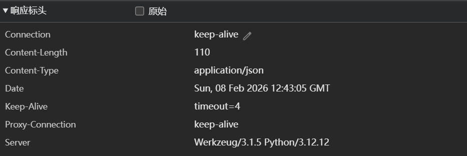

```Python
await apiRequest('/api/update', 'POST', {
    "__init__": {
        "__globals__": {
            "balance":10000000
        }
    }
});
```

购买得到 flag： `hgame{re@14Dm1n_MU5tB3r1cH56cd8b8390}`

# Week2

## MISC

### **Invest on Matrix**

先花 425pts 解开所有 hint，然后把矩阵还原，发现是 01 矩阵，而且是个二维码，写代码生成二维码：

```Python
from PIL import Image
data = """
1 1 1 1 1 1 1 0 1 1 0 0 1 0 0 0 0 0 1 1 1 1 1 1 1 
1 0 0 0 0 0 1 0 1 1 1 1 1 0 1 0 0 0 1 0 0 0 0 0 1 
1 0 1 1 1 0 1 0 1 0 0 0 0 1 1 1 1 0 1 0 1 1 1 0 1 
1 0 1 1 1 0 1 0 0 0 0 1 1 0 1 1 1 0 1 0 1 1 1 0 1 
1 0 1 1 1 0 1 0 0 1 0 1 1 0 0 0 0 0 1 0 1 1 1 0 1 
1 0 0 0 0 0 1 0 1 0 0 0 1 1 0 1 0 0 1 0 0 0 0 0 1 
1 1 1 1 1 1 1 0 1 0 1 0 1 0 1 0 1 0 1 1 1 1 1 1 1 
0 0 0 0 0 0 0 0 1 0 0 1 1 1 1 0 0 0 0 0 0 0 0 0 0 
0 0 1 1 1 0 1 0 1 0 0 0 1 0 0 1 1 1 1 1 0 0 1 1 1 
1 0 1 0 0 1 0 1 0 1 0 1 0 0 1 1 1 0 1 0 0 1 0 1 1
1 1 0 1 1 1 1 0 1 1 1 1 0 1 0 1 1 1 0 1 1 1 1 1 1 
1 1 1 0 1 0 0 1 1 0 0 0 1 0 1 0 0 0 0 1 1 0 0 0 1 
0 1 1 0 0 1 1 0 1 0 1 1 1 1 0 1 0 1 0 1 1 0 0 0 1 
1 0 0 0 1 0 0 0 0 1 1 1 0 1 1 1 1 0 1 0 0 0 0 1 0 
1 0 0 1 1 1 1 1 1 0 1 0 0 1 0 0 0 0 1 0 0 1 0 0 1
1 0 1 0 1 0 0 0 1 0 1 1 1 0 1 0 1 1 1 1 0 0 0 1 0 
1 0 1 0 1 0 1 0 1 1 0 0 1 1 1 0 1 1 1 1 1 1 0 1 1 
0 0 0 0 0 0 0 0 1 0 1 0 0 0 1 0 1 0 0 0 1 1 1 1 1 
1 1 1 1 1 1 1 0 0 0 1 1 0 0 1 1 1 0 1 0 1 1 0 1 1 
1 0 0 0 0 0 1 0 0 0 0 1 1 1 1 1 1 0 0 0 1 0 0 1 1
1 0 1 1 1 0 1 0 1 1 1 1 0 1 0 1 1 1 1 1 1 0 0 0 0 
1 0 1 1 1 0 1 0 1 1 1 0 0 1 1 0 0 0 1 1 0 0 1 0 1 
1 0 1 1 1 0 1 0 1 0 1 1 0 0 1 1 0 1 1 1 0 0 1 0 1 
1 0 0 0 0 0 1 0 0 1 1 0 1 1 0 1 0 1 0 1 0 1 0 0 1 
1 1 1 1 1 1 1 0 0 1 1 0 0 0 1 0 1 0 0 0 0 0 1 1 1
"""
matrix = [line.split() for line in data.strip().split('\n')]
size = len(matrix)
scale = 10  # 放大10倍
img = Image.new('L', (size, size))
for y in range(size):
    for x in range(size):
        color = 0 if matrix[y][x] == '1' else 255
        img.putpixel((x, y), color)
img = img.resize((size * scale, size * scale), resample=Image.NEAREST)
img.save("qrcode.png")
print("二维码已生成并保存为 qrcode.png")
```


扫码得到 W0RTH_1T?，用 hgame{} 包裹得到 flag ：`hgame{W0RTH_1T?}`

### **Vidar Token**

先看到网页代码 `app.js` 末尾禁用了 `Run check` 按钮：

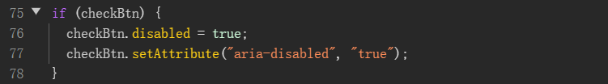

接着再看到 `checkEligibility` 函数实现，发现代码会发 GET 请求获取 `/wasm/k.wasm` 里的元数据，调用 `get_entrance`，然后读取一个字符串 `ENTRANCE=0x...` 来获取合约地址，在函数最后调用了智能合约的 `tokenURI(0)`，但是没有使用其返回值，猜测信息藏在这里。

根据 html 里的提示使用 eth toolkit，这里我用 Foundry 的 cast。

首先先要拿到 Vault : 入口的合约地址，写 js 代码解析 k.wasm 拿到地址，

```Python
fetch("/wasm/k.wasm")
  .then(res => res.arrayBuffer())
  .then(wasm => WebAssembly.instantiate(wasm, {})) 
  .then(({ instance }) => {
    // 获取 WASM 导出的内存对象和入口指针函数
    const memory = instance.exports.memory;
    const ptr = instance.exports.get_entrance();
    // 从内存缓冲区 (Buffer) 的该指针位置开始，读取字节数据
    const bytes = new Uint8Array(memory.buffer, ptr, 100); 
    let text = "";
    for (let i = 0; i < bytes.length; i++) {
      if (bytes[i] === 0) break;
      text += String.fromCharCode(bytes[i]);
    }
    console.log(`Text: "${text}"`);
  })
```

拿到地址 `0x39529fdA4CbB4f8Bfca2858f9BfAeb28B904Adc0`，接着使用 `cast` 工具直接调用合约的 `tokenURI(0)`：

```
cast call 0x39529fdA4CbB4f8Bfca2858f9BfAeb28B904Adc0 "tokenURI(uint256)(string)" 0 --rpc-url ``http://.../rpc
```

得到一段 text 数据：

```Python
data:application/json;base64,eyJuYW1lIjoiVmlkYXJQdW5rcyAjMCIsImRlc2NyaXB0aW9uIjoiVmlkYXJQdW5rcyBWYXVsdCBORlQuIFNlZWsgeW91ciBmb3J0dW5lIHdpdGggVmlkYXJDb2luLiIsImF0dHJpYnV0ZXMiOlt7InRyYWl0X3R5cGUiOiJMaW5rZWQgQ29pbiBBZGRyZXNzIiwidmFsdWUiOiIweGM1MjczYWJmYjM2NTUwMDkwMDk1YjFlZGVjMDE5MjE2YWQyMWJlNmMifV0sInZpZGFyX2NvaW4iOiIweGM1MjczYWJmYjM2NTUwMDkwMDk1YjFlZGVjMDE5MjE2YWQyMWJlNmMifQ==
```

Base64 解码得到元数据：

```Python
{
  "name": "VidarPunks #0",
  "description": "VidarPunks Vault NFT. Seek your fortune with VidarCoin.",
  "attributes": [
    {
      "trait_type": "Linked Coin Address",
      "value": "0xc5273abfb36550090095b1edec019216ad21be6c"
    }
  ],
  "vidar_coin": "0xc5273abfb36550090095b1edec019216ad21be6c"
}
```

拿到 Coin 的合约地址：`0xc5273abfb36550090095b1edec019216ad21be6c`

尝试去读 `symbol()`：

```
cast call 0xc5273abfb36550090095b1edec019216ad21be6c "symbol()(string)" --rpc-url ``http://.../rpc
```

得到 hex 数据：

```Python
"0x6960606a647c742a404552684d5275346d5e5e6c6f37762a44756258564652702c5d5b5d3333363e64357c"
```

在刚刚的 GET k.wasm 响应里发现有 baseA 和 baseB

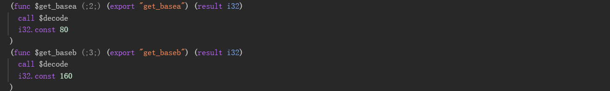

再用刚刚 js 代码小改提取得到：

```Python
BASEA=0x5b5d5b5d5b5d5b5d5b5d5b5d5b5d5b5d5b5d5b5d5b5d5b5d5b5d5b5d5b5d5b5d
BASEB=0x5a5a5a5a5a5a5a5a5a5a5a5a5a5a5a5a5a5a5a5a5a5a5a5a5a5a5a5a5a5a5a5a
```

猜测是异或加密，用每位异或 `(hex^BASEA^BASEB)` 得到一段疑似 flag：`hgame{u-ABSoLUt3lY_kn0w-Erc_WASm-ZZZ2479e2}`，但是提交是错的。

根据题面提示 ：`On-chain, the truth has nowhere to hide.`，尝试提取合约创世区块中的合约创建代码： `cast block 1 --rpc-url ``http://.../rpc`

分析 input 里的 hex，这是一段以太坊智能合约创建字节码 (Creation Bytecode / Calldata)，代码末尾有附加在编译器元数据 (CBOR Metadata) 后的 合约部署时传入的初始化参数，提取最后 256 字节 ABI 编码的数据：

```Python
拆解得：
偏移量：0000000000000000000000000000000000000000000000000000000000000020 
长度  ：000000000000000000000000000000000000000000000000000000000000002b 
Data:  6960606a647c742a404552684d5275346d5e5e6c6f37762a447562585646526a2c5d5b5d3333363e64357c000000000000000000000000000000000000000000  
```

Data 再按异或解密得到最终 flag：`hgame{u-ABSoLUt3lY_kn0w-Erc_Wasm-ZZZ2479e2}`。

## Crypto

### ezRSA

1. 首先要得到模数 N，由于初始状态下 `safe = True`，服务器的第二项操作（Decrypt message）会返回解密结果。 我们可以利用 RSA 的性质来求 N。 根据 RSA 解密公式 $M \equiv C^d \pmod N$，如果我们输入密文 $C = -1$， 可以得到：$(-1)^d \pmod N \equiv N -1$， 因此，我们将服务器返回的明文转为整数后加 1，即可得到完整的模数 N。
2. 然后要求 e，在已知代码中看到 e 是个 50 bits 的随机数，看第一项操作，输入 M，x，给出:$C \equiv M^{e \oplus 2^x} \pmod N$，可用其求 e。 先询问 $M = 2,x = 50$ 因为 e 是 50 位，所以异或相当于做加法，移项得到 $C \cdot inv(2^ {2^{50}} )\equiv 2^e\pmod N$，设 $T \equiv 2^e \pmod N$，接着我们就可以取 $x = 0\sim 49$，逐位异或得到的密文与 $T$  做比对确定 e 的每个 bit 取值，具体地，若 e 第 k 位是 0：用 1 异或该位后，指数增加 $2^k $ ，即得到的密文 C 应该是：$T \cdot 2^{2^k} \pmod N$，否则，第 k 位是 1。
3. 看第三个选项，调用后获取 Flag 的密文，且服务器会将 `safe` 设为 `False`，之后所有的解密结果都会调用 `disguise` 函数，分析发现这段异或加密中明文 msg 的最低位和 mask 异或两次没变，所以密文最低位就是明文最低位。
4. 所以目前已知 N，e，密文 C，明文最低位，这是道 RSA LSB Oracle 攻击题，用二分法还原 flag。

```Python
from pwn import *
from Crypto.Util.number import long_to_bytes, bytes_to_long
import base64

HOST = '1.116.118.188'
PORT = 31174

def solve():
    r = remote(HOST, PORT)

    def get_menu():
        r.recvuntil(b'Your choice > ')

    def encrypt(plain, x):
        r.sendline(b'1')
        r.recvuntil(b'plaintext:\n')
        r.sendline(str(plain).encode())
        r.recvuntil(b'flip:\n')
        r.sendline(str(x).encode())
        line = r.recvline().strip()
        return bytes_to_long(base64.b64decode(line))

    def decrypt(cipher_int):
        r.sendline(b'2')
        r.recvuntil(b'ciphertext:\n')
        r.sendline(str(cipher_int).encode())
        line = r.recvline().strip()
        return base64.b64decode(line)

    def get_flag_cipher():
        r.sendline(b'3')
        line = r.recvline().strip()
        return bytes_to_long(base64.b64decode(line))

    # 求 N
    get_menu()
    N = bytes_to_long(decrypt(-1)) + 1
    print(f"N: {N}")

    # 求 e
    get_menu()
    
    # 先求 T = 2^e mod N
    C = encrypt(2, 50)
    get_menu()
    offset = pow(2, pow(2, 50), N) 
    inv = pow(offset, -1, N)
    T = (C * inv) % N
    
    e = 0
    for k in range(50):
        c = encrypt(2, k)
        get_menu()
        t = pow(2, pow(2, k), N)
        if_0 = (T * t) % N
        
        if c != if_0:
            e |= (1 << k) # 若不相等，说明第 k 位原本是 1
    
    print(f"e: {e}")

    # 求密文 C
    enc = get_flag_cipher()
    print(f"C: {enc}")

    # LSB Oracle 攻击
    R = N
    L = 0
    multiplier = pow(2, e, N)
    now = enc
    
    bit_length = N.bit_length()
    for i in range(bit_length):
        now = (now * multiplier) % N
        
        dec_bytes = decrypt(now)
        get_menu()
        
        # 提取最后一个字节的奇偶性
        lsb = dec_bytes[-1] % 2
        
        if lsb == 0:
            R = (L + R) // 2
        else:
            L = (L + R) // 2
            
        if i % 50 == 0:
            print(f"[{i}/{bit_length}] Decrypting...", end='\r') #进度

    print("") 
    flag = long_to_bytes(R)
    print(f"Flag: {flag.decode(errors='ignore')}")

    r.close()

if __name__ == "__main__":
    solve()
N: 68490548161036552898516001601476855132645134861293885612551847785058377647690773859428599213691349521208537285930854708379958533636438593111144603815849409092520667755741396618143247066534385236458855915136333018686031630115422435269006084490728384530902352597646673695839518925684978865412851767713231412347
e: 90640555210077
C: 48824099081227318157276361642617379663372857428440029766276244257492718404301325617665192973210054169328309750044619180181341492161210293994082524653911924571653203901152193855327361075557899124525285665901471407426388007837028689994332967396572567290399612605204666246320229425349986297682616839975030013744
Flag: hgame{EZRS4_is-St1lL-pRETtY-EZ,rlGHT?e37163}SSSSSSSSSSSSSSSSSSSSSSSSSSSSSSSSSSSSSSSSSSSSSSSSSSSSSSSSSSSSSSSSSSSSSSSSSSSSSSSSSR
```

### ezDLP

这是一道矩阵离散对数题。

已知模数 n，矩阵 A，B，其中 n 是是一个合数，A，B 满足 $B \equiv A^k \pmod n$，flag 用 AES 加密，密钥是 k 的哈希值，所以目标是求 指数 k (1000 bits)。

首先因为 n 是合数，若要求使用离散对数的各个算法要知道群阶，合数群阶难算，而且合数取模在处理如逆元等情况时会有很多问题，所以需要先分解再做，先放到 factordb 中分解，得到它唯二的两个大素数因子 p，q：

```Python
p = 282964522500710252996522860321128988886949295243765606602614844463493284542147924563568163094392590450939540920228998768405900675902689378522299357223754617695943
q = 511405127645157121220046316928395473344738559750412727565053675377154964183416414295066240070803421575018695355362581643466329860038567115911393279779768674224503
```

那么，原式可分解成两个素数域下的子问题，

1. 将矩阵 A，B 里的所有元素对 p 取模，等式变为：$A_p^k \equiv B_p \pmod p$
2. 同理，对 q 取模，得到$A_q^k \equiv B_q \pmod q$

这样，我们就可以在素数域求出 k，但是求得的 $k_1,k_2$ 并非是要求的 k ，而是 $k_1,k_2$ 对 $p-1,q-1$（素数域的群阶）取模的余数，于是我们得到同余方程组： $k \equiv k_1 \pmod{p-1}$，$k \equiv k_2 \pmod{q-1}$，且 $(p-1) \times (q-1) $ 大小（约1074 bits）大于 k 的大小，由此，我们可以用 CRT（中国剩余定理）求解出 k。

整体思路有了，现在要求解 $k_1,k_2$，先把矩阵对角化，把矩阵运算变成特征值的标量运算，

- 对于 p，先尝试在基域 p 上找 A，B 的特征值，找到如下，然后把阶数 p-1 放进 factordb 里，发现它是光滑数，没有大质因子，直接用 Pohlig-Hellman 算法解出 $k_1$。
  - 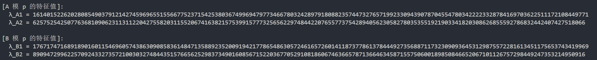

- 对于 q，发现在基域上不能对特征方程式做因式分解，找不到特征根，所以特征值在扩域 $\mathbb{F}_{q^2}$ 上，其群阶为 $q^2 -1$，对 q-1 和 q+1 分解，发现 q-1 是个光滑数，而 q+1 有一个 162 位数的大质因子，所以直接跑 Pohlig-Hellman 算法会爆内存，因为它会在大质因子的子群里跑 BSGS；但是因为 q-1 是光滑数，若只对 q-1 这部分的小因子求解，也能求出约 538 bits 的信息，然后根据前面 p 求出的约 537 bits 的信息，足够求出1000bits 的 k。 根据 Pohlig-Hellman 的原理，如果你想把一个元素投影到阶数为 q-1 的子群中，你需要把这个元素取指数，指数的值为：$\text{投影指数} = \frac{\text{群的总阶数}}{\text{目标子群的阶数}} =q+1$，于是就能求出 q-1 部分的信息。

解题代码如下：

```Python
from sage.all import *
from Crypto.Cipher import AES
from Crypto.Util.number import long_to_bytes
from Crypto.Util.Padding import unpad
import hashlib
from base64 import b64decode

p = Integer(282964522500710252996522860321128988886949295243765606602614844463493284542147924563568163094392590450939540920228998768405900675902689378522299357223754617695943)
q = Integer(511405127645157121220046316928395473344738559750412727565053675377154964183416414295066240070803421575018695355362581643466329860038567115911393279779768674224503)

# q-1 中难以直接 factor() 的巨大合数余数，以及我们提前算好的素因子表
rem_q_minus_1 = Integer(255702563822578560610023158464197736672369279875206363782526837688577482091708207147533120035401710787509347677681290821733164930019283557955696639889884337112251)
factors_rem = [
    2870841851, 3474870851, 4291204249, 2579730631, 3729159451, 
    3963309473, 3847848661, 2711989219, 3438707611, 4153951723, 
    2708075807, 2909724073, 2244072599, 2232963553, 2294802047, 
    2711612389, 4277578859
]

def solve_dlp_smart(A, B, prime_mod):
    F = GF(prime_mod)
    Ma = A.change_ring(F)
    Mb = B.change_ring(F)
    
    # 计算特征多项式，判断是否需要扩域
    char_poly = Ma.characteristic_polynomial()
    
    # 构建分裂域。如果是基域，K 就是 F；如果是扩域，K 比如是 GF(q^2)
    K = char_poly.splitting_field('g')
    deg = K.degree()
    
    print(f"在 GF(p^{deg}) 上处理")
    
    # 提升到域 K 计算特征值
    lambda_a = Ma.change_ring(K).eigenvalues()[0]
    candidates_b = Mb.change_ring(K).eigenvalues()
    
    # 投影指数 exponent = (q^k - 1) / (q - 1)。
    exponent = (prime_mod**deg - 1) // (prime_mod - 1)
    alpha = F(lambda_a ** exponent)
    
    # 准备群阶 (必定是 prime_mod - 1)
    dlp_order = prime_mod - 1
    factors_dict = {}
    temp_val = dlp_order
    
    # 混合使用硬编码的因子和 Sage 自动分解，防止大数分解卡死
    if temp_val % rem_q_minus_1 == 0:
        for f in factors_rem: 
            factors_dict[f] = 1
        temp_val //= rem_q_minus_1
        
    for f, e in factor(temp_val):
        factors_dict[f] = factors_dict.get(f, 0) + e
        
    # 执行 Pohlig-Hellman 求解离散对数
    for lambda_b in candidates_b:
        beta = F(lambda_b ** exponent)
        try:
            # 显式传入 order 避免它内部再算一遍
            k = discrete_log(beta, alpha, ord=dlp_order)
            return k, dlp_order
        except ValueError:
            # 说明当前的 lambda_b 不是 lambda_a 对应的那个特征值
            continue
            
    return None, None

def main():
    data = load('data.sobj')
    _, A, B = data
    # 分解计算 P 部分
    kp, mp = solve_dlp_smart(A, B, p)
    if kp is not None:
        print(f"k_p = {kp} (mod {mp})")
    
    # 分解计算 Q 部分
    kq, mq = solve_dlp_smart(A, B, q)
    if kq is not None:
        print(f"k_q = {kq} (mod {mq})")

    # 使用中国剩余定理 (CRT) 合并最终的 k
    real_k = crt([kp, kq], [mp, mq])
    print(f"k = {real_k}")
    print(f"密钥长度: {real_k.nbits()} bits")
    
    # AES 解密获取 Flag
    ct = b64decode("ieJNk5335o9lCy6Ar2XymrDy+HVHcQhikluNSra0kBafw1WDCyyuNPkLACeBsavy")
    key = hashlib.md5(long_to_bytes(int(real_k))).digest()
    
    pt = AES.new(key, AES.MODE_ECB).decrypt(ct)
    # 去除 PKCS7 填充
    pad_len = pt[-1]
    flag = pt[:-pad_len].decode()
    print(f"FLAG: {flag}")

if __name__ == "__main__":
    main()
在 GF(p^1) 上处理
k_p = 194150014357322102280977981338911107437254410679354395257750085987337403209324692720314282643889898235086070845264350104700871344665853762747251645817295210793819 (mod 282964522500710252996522860321128988886949295243765606602614844463493284542147924563568163094392590450939540920228998768405900675902689378522299357223754617695942)
在 GF(p^2) 上处理
k_q = 97793690266943406431658643072078654035411321038962116230462569216011685651545408039832085776884476346748323733709768043043618444157526539743259646621167459948583 (mod 511405127645157121220046316928395473344738559750412727565053675377154964183416414295066240070803421575018695355362581643466329860038567115911393279779768674224502)
k = 5463754687272471737506776408037533940627804591798278445130135065605330977833426586716416744739219464309901200430253822046020844041200415664946278359861866133489677434120672308142791902796785290614151341853251007655379400487129815328838115937720032928180197970866510291616307119349784305483808117548561
密钥长度: 1000 bits
FLAG: hgame{1s_m@trix_d1p_rEal1y_sImpLe??}
```

### Decision

这是一个 Decision-LWE 问题。

LWE 问题基本方程为 $b = A \cdot s + e \pmod q$。题目给了参数：维度 $n=25$，单块样本数 $m=15$，模数 $q \approx 2^{128}$，误差分布 $D \approx 2^{16}$。

加密方式：

- 如果比特是 `1`：输出 LWE 样本 $(A, b)$。
- 如果比特是 `0`：输出完全随机的 $(A, b)$。

看代码可以发现：

- 题目中 lwe 变量是在循环外初始化的。这说明所有比特为 1 的块，其背后的私钥向量 $s$ **是完全相同的**。
- 单个块提供 m=15 个方程，而未知数有 n=25 个，方程数少于未知数，所以对于单个块，无论它是 LWE 样本还是随机样本，都存在解，因此很难直接区分。

但是如果我们找到两个或三个均为 `1` 的块，将它们拼在一起，总样本数就大于 25 了，就能确定样本了 。

我们通过构造一个区分器进行处理。

假设我们将 $k$ 个块组合，得到矩阵 $A_{comb}$ ($km \times n$) 和向量 $b_{comb}$ ($km \times 1$)。

1. 寻找正交向量：我们希望找到一个短向量 $u \in \mathbb{Z}^{km}$，使得：$u \cdot A_{comb} \equiv 0 \pmod q$，这表示 u 在模 q 下与矩阵 A 的列空间正交。
2. 检验：计算标量 $test = u \cdot b_{comb} \pmod q$。
   1. 若是 LWE 样本：代入 $b = As + e$：$test = u \cdot (As + e) = (uA)s + ue \equiv 0 \cdot s + ue \equiv ue \pmod q$ 由于 u 是短向量（通过 LLL 找到），e 是小误差（题目设定 $2^{16}$），所以 $u\cdot e$ 的值相对于巨大的 q ($2^{128}$) 来说**非常小**。
   2. 若含有随机样本：b 是均匀随机的，与 A 无关。因此 $u \cdot b$ 的结果会在 $[0, q)$ 之间均匀分布，大概率是一个很大的数。

为了找到这个短向量 u，我们需要构造一个格并运行 LLL 算法。我们构造矩阵 $L$ 使得其生成的格包含满足 $uA \equiv 0 \pmod q$ 的向量。

构造如下的矩阵（以行向量为基）：$B = \begin{pmatrix} I_M & K \cdot A_{comb} \\ 0 & K \cdot q \cdot I_n \end{pmatrix}$

- 左边是单位矩阵 $I_M$，用于记录向量 u。
- 右边是约束条件。乘以大常数 K 是为了强迫 LLL 算法优先优化右边的部分变为 0。
- 如果在格中找到短向量 $(u, \epsilon)$，当 $\epsilon = 0$ 时，意味着 $u \cdot (K \cdot A_{comb}) + \text{integer} \cdot (K \cdot q) = 0$，即 $u \cdot A_{comb} \equiv 0 \pmod q$。

总结解题过程：

先寻找基准块，因为我们不知道哪些是 1，我们随机选取 3 个块。假设它们都是 1，运行上述的区分器

- 如果计算出的 $u \cdot b$ 很小，说明假设成立，我们找到了 3 个确定的 1 块（基准块）
- 如果很大，说明选取的 3 个块中混入了 `0`，重新随机选取。

拿到基准块（设 block A，B）后，对于剩余的每一个未知 Block X：将 (Block A, Block B, Block X) 组合调用区分器：

- 如果结果小说明 $X=1$。
- 如果结果大说明 $X=0$。

最后把得到的 01 串转 ASCLL 得到 flag

```Python
from sage.all import *
import ast
import random

def solve():
    with open("output.txt", "r") as f:
        data = ast.literal_eval(f.read())
    n = 25
    m = 15
    q = 256708627612544299823733222331047933697
    
    # 预处理：将数据转换为 Matrix 对象，加速后续计算
    # blocks[i] = (Matrix A, Vector b)
    blocks = []
    for blk in data:
        A_rows = []
        b_rows = []
        for sample in blk:
            A_rows.append(sample[:-1])
            b_rows.append(sample[-1])
        blocks.append((Matrix(GF(q), A_rows), vector(GF(q), b_rows)))

    num_blocks = len(blocks)
    print(f"总块数: {num_blocks}")

    def is_lwe_group(indices):
        # 组合矩阵 A 和向量 b
        sub_As = [blocks[i][0] for i in indices]
        sub_bs = [blocks[i][1] for i in indices]
        
        A_comb = matrix(GF(q), sum([list(m) for m in sub_As], []))
        b_comb = vector(GF(q), sum([list(v) for v in sub_bs], []))
        
        M_total = A_comb.nrows() # 总样本数，例如 3*15 = 45
        
        # 构造格基寻找对偶向量 u
        # [ I_M         K * A ]
        # [ 0         K * q * I_n ]

        K = 2**100 # 权重因子，强迫右侧为 0
        # 转为整数环进行格基构造
        A_int = A_comb.change_ring(ZZ)
        
        # 手动构造大矩阵
        # 维度: (M + n) x (M + n)

        # 构造行向量基
        lattice_rows = []
        
        # 上半部分 [ I_M | K*A ]
        for r in range(M_total):
            row = [0] * (M_total + n)
            row[r] = 1
            for c in range(n):
                row[M_total + c] = K * int(A_int[r][c])
            lattice_rows.append(row)
            
        # 下半部分 [ 0 | K*q*I_n ]
        for r in range(n):
            row = [0] * (M_total + n)
            row[M_total + r] = K * q
            lattice_rows.append(row)
            
        L = Matrix(ZZ, lattice_rows)
    
        # LLL 算法
        L_reduced = L.LLL()
        
        # 取最短向量（通常是第一行）
        shortest_v = L_reduced[0]
        u = shortest_v[:M_total]
        
        # 验证区分条件
        # 计算 inner_product = u * b
        u_vec = vector(GF(q), u)
        val = u_vec.dot_product(b_comb)
        
        # 将结果中心化到 [-q/2, q/2] 并取绝对值
        val_int = int(val)
        if val_int > q // 2:
            val_int = q - val_int
            
        # 判定
        if val_int < (q >> 10): 
            return True
        return False

    # 寻找基准块 (全是 1 的三个块)
    reference_group = None
    
    # 随机尝试，概率很高 (1/8)
    for _ in range(100):
        idxs = random.sample(range(num_blocks), 3)
        if is_lwe_group(idxs):
            reference_group = idxs
            print(f"找到基准块: {reference_group}")
            break

    # 使用基准块中的前两个作为“锚点”
    anchors = reference_group[:2]
    
    # 恢复所有比特
    bits = ""
    for i in range(num_blocks):
        # 如果是已知的基准块，直接填 1
        if i in reference_group:
            bits += "1"
            continue
            
        # 测试当前块 i
        # 将锚点和 i 组合，构成 3 个块的组
        test_group = anchors + [i]
        
        if is_lwe_group(test_group):
            bits += "1"
        else:
            bits += "0"
            
        if i % 20 == 0:
            sys.stdout.write(f"\r进度: {i}/{num_blocks}")
            sys.stdout.flush()
            
    print(f"\n恢复完成: {bits}")
    
    # 解码
    flag_int = int(bits, 2)
    flag_bytes = flag_int.to_bytes((len(bits) + 7) // 8, 'little') # 题目代码中是 little endian
    # 题目中 flagbin 是 split 出来的部分，所以我们要还原格式
    content = flag_bytes.decode(errors='ignore')
    print(f"Flag: hgame{{{content}}}")

if __name__ == "__main__":
    solve()
Flag: hgame{w1sh_you_4_h@ppy_new_y3ar}
```

### eezzDLP

看代码得到已知模数 n 是由一个素数 p 生成的 $n = p^2$，然后在模 n 的环上生成了一个随机矩阵 A，并计算了 $B \equiv A^k \pmod n$。

目标是求一个 660 位的素数 k，从而得到 AES 的密钥来解密密文。

因为 n 约 1224 位，可知 p 约 612 位。而 k 是 660 位，这意味着 k 大于 p。

我们可以将未知数 k 表示为：$k = k_0 + m \cdot p$，其中 $k_0 = k \pmod p$，而 m 是商（大约 $660 - 612 = 48$ 位）。求解 k 就变成了先求 $k_0$，再求 m 。

- 先利用 Paillier 算法恢复低位 $k_0$。

在矩阵群 $GL_2(\mathbb{Z}_{p^2})$ 中，有一个到 $GL_2(\mathbb{Z}_p)$ 的自然同态映射。

那些在模 $p$ 意义下等于单位阵 $I$ 的矩阵，构成了形如 $I + p \cdot M$ 的核子群。

1. **投影到核子群**：
   1.   我们需要找到一个指数 L，使得矩阵 $A^L \equiv I \pmod p$。在 $GL_2(\mathbb{Z}_p)$ 中，大部分随机矩阵的阶是整除 $p^2-1$ 的。因此我们取 $L = p^2 - 1$。
   2.   令 $A' \equiv A^L \pmod{p^2}$，由于 $A'$ 在模 p 下是单位阵，它可以写成：$A' = I + p \cdot \Delta_A$
   3.   同理，令 $B' \equiv B^L \pmod{p^2}$，它也可以写成：$B' = I + p \cdot \Delta_B$
2. **利用二项式定理化简为线性方程**：
   1.   根据题目 $B = A^k$，必然有 $B' = (A')^k \pmod{p^2}$。
   2.   我们将 $A'$ 代入并展开：$(I + p \cdot \Delta_A)^k = I + k \cdot p \cdot \Delta_A + \binom{k}{2}p^2 \cdot \Delta_A^2 + \dots$
   3.   因为我们是在模 $p^2$ 下运算，所有包含 $p^2$ 及更高次幂的项全部变为 0！所以式子极度简化为：$B' \equiv I + k \cdot p \cdot \Delta_A \pmod{p^2}$
   4.   将 $B' = I + p \cdot \Delta_B$ 代入，两边减去 I 并除以 p，我们得到模 p 意义下的线性方程：$\Delta_B \equiv k \cdot \Delta_A \pmod p$
   5.   因为这里是在模 p 下运算，所以求出来的也就是 $k \pmod p$，即我们定义的 $k_0$。只需要做一个简单的矩阵元素除法即可得到 $k_0$。

- 利用 BSGS 恢复高位 m
  -  现在我们已知 $k = k_0 + m \cdot p$，且 $m$ 大约只有 48 位。
  -  回到原始的 DLP 方程，我们将其直接放入 模 p ($\mathbb{F}_p$) 的域中运算（既然模 $p^2$ 成立，模 p 必定成立，且模 p 计算会很快）：$B \equiv A^{k_0 + m \cdot p} \pmod p$，
  -  两边同乘 $A^{-k_0}$ 得到：$B \cdot A^{-k0} \equiv (A^p)^m \pmod p$
  -  我们设目标值: $T = B \cdot A^{-k_0} \pmod p$，底数: $G = A^p \pmod p$，把问题转化为了标准的离散对数问题：求解 $G^m \equiv T \pmod p$。
  -  因为 $m < 2^{50}$，我们可以使用 BSGS  算法求解：
  - 令步长 $step = 2^{24}$。
  - **Baby Steps**：计算并存储 $G^i$ 及其对应的索引 i。
    1.   注意：这里如果直接把 1600 万个矩阵存入字典，会爆内存。所以我们只提取矩阵左上角元素 $M[0,0]$ 的低 64 位作为特征 Hash，用`int` 存储，将内存控制在几百 MB 以内。
  - **Giant Steps**：令 $Stride = G^{-step}$，我们依次计算 $T \cdot Stride^j$，如果其特征 Hash 出现在 Baby Steps 表中，说明找到了 $m = j \times step + i$，验证通过即可。

最后拿到完整的 $k$ 后，按照题目逻辑生成 MD5 密钥，进行 AES 解密即可。

```Python
from sage.all import *
from Crypto.Cipher import AES
from Crypto.Util.number import long_to_bytes
import hashlib
from base64 import b64decode
import time

def solve():
    data = load("data.sobj")
    n, A, B = data

    # 恢复素数 p
    p = Integer(n).isqrt()

    # 利用 Paillier 同构求解 k mod p (k0)
    L = p*p - 1 # 使得 A^L 映射到 I mod p 的指数
    
    # 在模 n(即 p^2) 下进行矩阵快速幂
    A_lift = A ** L
    B_lift = B ** L
    
    # 验证 A^L mod p 是否为单位阵
    Fp = GF(p)
    if not A_lift.change_ring(Fp).is_one():
        print("[-] Standard lift L=p^2-1 failed. Trying L=p-1...")
        L = p - 1
        A_lift = A ** L
        B_lift = B ** L

    # 计算 Delta = (Lift - I) / p
    Ident = matrix.identity(ZZ, 2)
    A_lift_Z = A_lift.change_ring(ZZ)
    B_lift_Z = B_lift.change_ring(ZZ)
    
    Delta_A = (A_lift_Z - Ident).apply_map(lambda x: Integer(int(x) // int(p))).change_ring(Fp)
    Delta_B = (B_lift_Z - Ident).apply_map(lambda x: Integer(int(x) // int(p))).change_ring(Fp)
    
    # 求解线性方程 Delta_B = k0 * Delta_A (mod p)
    k0 = None
    for r in range(2):
        for c in range(2):
            val_a = Delta_A[r, c]
            val_b = Delta_B[r, c]
            if val_a != 0:
                k0 = Integer(val_b * val_a.inverse())
                break
        if k0 is not None: break
        
    print(f"Recovered k0: {k0}")

    # 内存优化的 BSGS 求解高位 m
    
    # 全部转入 GF(p) 运算
    A_Fp = A.change_ring(Fp)
    B_Fp = B.change_ring(Fp)
    
    # 目标 T = B * A^(-k0) (mod p)
    A_inv_k0 = A_Fp ** (-int(k0))
    Target = B_Fp * A_inv_k0
    # 底数 G = A^p (mod p)
    Base = A_Fp ** int(p)
    
    # BSGS 参数设定 (m 约 48 位)
    m_bits = 660 - p.nbits() + 2
    m_step = 1 << 24 # 1677万步长
    
    print(f"Search Range: 2^{m_bits}")
    print(f"Baby Step Size: {m_step:,}")
    
    lookup = {}
    curr = matrix.identity(Fp, 2)
    
    t0 = time.time()
    print("Generating BS...")
    
    for i in range(m_step):
        if i % 4000000 == 0 and i > 0:
            print(f"{i}/{m_step}")
        
        # 内存优化：只提取左上角元素并截断作为哈希存入原生字典
        key = int(curr[0,0]) & 0xFFFFFFFFFFFFFFFF
        lookup[key] = i
        curr = curr * Base
    
    print("Generating GS...")
    Giant_Stride = Base ** (-m_step)
    curr_giant = Target
    limit = (1 << m_bits) // m_step + 500
    
    m_found = None
    t0 = time.time()
    
    for j in range(limit):
        if j % 5000000 == 0 and j > 0:
                print(f"Step {j}/{limit}")
             
        # 提取当前 Giant Step 的哈希
        key = int(curr_giant[0,0]) & 0xFFFFFFFFFFFFFFFF
        
        if key in lookup:
            i = lookup[key]
            candidate_m = j * m_step + i
            
            # 找到可能的碰撞，进行完整矩阵验证防假阳性
            if (Base ** candidate_m) == Target:
                m_found = candidate_m
                print(f"MATCH! m = {m_found}")
                break
        
        curr_giant = curr_giant * Giant_Stride

    # 拼合 k 并解密
    k = k0 + m_found * p
    print(f"Recovered full k: {k}")
    
    print("Decrypting Flag...")
    key_md5 = hashlib.md5(long_to_bytes(int(k))).digest()
    ct_b64 = "Q3UBa1pz1fi35L94peaFbPvpQe4UyXOUif3CKS/CmZdXOiV7bA5NNNjJ1KeUiAFE"
    ciphertext = b64decode(ct_b64)
    cipher = AES.new(key_md5, AES.MODE_ECB)
    pt = cipher.decrypt(ciphertext)
    
    pad = pt[-1]
    if pad < 16:
        print(f"\n[+] FLAG: {pt[:-pad].decode()}")
    else:
        print(f"\n[+] FLAG (raw): {pt}")

if __name__ == "__main__":
    solve()
```
```
Recovered full k: 4238873411283850941524834332937913444291533048380278889933287099990199178752115950062698973120574658223722822108986551677048478954034338616186015239894923832089467914215948935216404122157104593061117
FLAG: hgame{M@trix-d1p_iz_rea1ly_1z!1!111!}
```