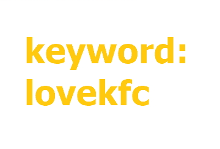
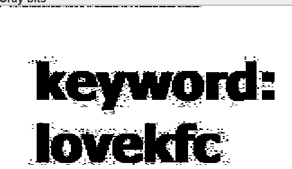

>有趣的加密
---
## 题目描述：格式为QCTF{XXX}
---
## WP

附件提示了 keyword：lovekfc



放到 stegsolve 里改颜色通道，发现顶上有像素点：



结合给了密钥，应该是 LSB 隐写，找工具解密后得到隐写内容：

```
PVSF{vVckHejqBOVX9C1c13GFfkHJrjIQeMwf}
```

尝试多种常见加密无果，最后搜索得到是 Nihilist cipher（虚无密码），一个矩阵式替换密码。

```
这道题关键字为：LOVEKFC
原26个英文字母为 ABCDEFGHIJKLMNOPQRSTUVWXYZ
把关键字提前后为 LOVEKFCABDGHIJMNPQRSTUWXYZ
```

Decode:

```python
a1 = "ABCDEFGHIJKLMNOPQRSTUVWXYZ"
b1 = "LOVEKFCABDGHIJMNPQRSTUWXYZ"
a2 = a1.lower()
b2 = b1.lower()

str = "PVSF{vVckHejqBOVX9C1c13GFfkHJrjIQeMwf}"
for i in str:
    if(i in b1):
        print(a1[b1.index(i)],end="")
    elif(i in b2):
        print(a2[b2.index(i)],end="")
    else:
        print(i,end="")
```

Output:

```
QCTF{cCgeLdnrIBCX9G1g13KFfeLNsnMRdOwf}
```